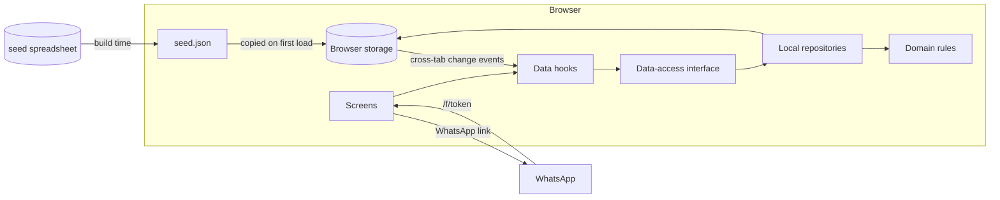

# Chandra Honda · Post-Service Feedback (PSF)

A mobile-first web app that replaces the paper post-service questionnaire for Chandra Honda: support staff create a WhatsApp feedback link from a job card, and the customer answers a short form on their phone.

**Status:** phase 1 demo on sample data. The support-to-customer loop is built (milestone M1). The admin console (analytics, alerts, responses, audit, users) is milestone M2 and is not built yet.

**Live demo:** https://chandra-psf.vercel.app (see [docs/DEMO-GUIDE.md](docs/DEMO-GUIDE.md) for the presenter walk-through).

## Architecture



Layers, from the low-level design (`docs/LLD.md` §0):

| Module | Responsibility |
|---|---|
| Domain | Pure rules: questionnaire and show/hide logic, alert rules, metrics, phone, job card and WhatsApp helpers |
| Data-access contract | One typed interface the screens use; phase 2 swaps only its implementation |
| Local store | Browser storage with cross-tab locking and change events; simulated failed save |
| Seed pipeline | Builds the sample data fixture; dates move to "today" on load |
| Screens | Sign-in, support (job card lookup, links), customer form, admin (M2) |

Architecture notes: `docs/LLD.md`. `docs/ARCHITECTURE.md` is not written yet.

## Features (what runs now)

- **Sign-in** with quick buttons for the sample Admin, Support 1 and Support 2 accounts, or email and password.
- **Support:** look up a job card (case, spaces and dashes ignored), see the customer and vehicle details, edit the mobile number, generate a link, send it on WhatsApp, copy it, search links, resend, regenerate or cancel.
- **Customer form** at `/f/<token>`: personal welcome, five category steps with follow-up questions, callback question, thank-you page. Answers are restored after a refresh. Expired, already-submitted and invalid links show their own pages.
- **Alerts** are created when a submission has a rating of 1 or asks for a callback. The alerts list itself is M2.
- **Two tabs of one browser** stay in step: a change in one tab shows in the other without a reload.
- **Reset demo data** on the sign-in screen restores the sample data.
- **Simulated failed save** (admin sidebar or More menu, or `?demoFail=1` in the address) makes the next save in that tab fail once, showing "Couldn't save, try again".

Planned for M2: the admin overview with analytics, alerts queue, responses with edit, delete and restore, audit log, user management.

## Tech stack

Next.js 16 (App Router) · React 19 · TypeScript · Tailwind CSS 4 with shadcn/ui · Zod · TanStack Query · Recharts (M2) · Vitest · Playwright · ESLint · Prettier · dependency-cruiser. Data is kept in the browser's local storage; there is no database in phase 1.

## Data safety

- **No backup.** Nothing is copied to a server.
- **Data lives only in the browser that made it.** Every link, response, alert, user and audit entry stays in that browser until you press **Reset demo data** (or clear the browser's site data).
- **Other devices do not see it.** A phone, a laptop or another browser starts from the sample data and keeps its own copy. A link opened on another device shows the welcome page, but the answers stay on that device.
- **Sample data only.** The demo must not hold real customer data. The site asks search engines not to index it.

## Setup

Requirements: Node.js 24 or newer, pnpm 11, git. Optional: gitleaks v8 (the secrets check in `scripts/check.sh`).

```bash
git clone <repository-url> chandra-psf
cd chandra-psf
pnpm install
cp .env.example .env                 # the app reads its settings from .env
git config core.hooksPath .githooks  # once per clone: pre-commit hook
```

Environment keys (all listed in `.env.example`; none is a secret):

| Key | What it does | Notes |
|---|---|---|
| `NEXT_PUBLIC_DEMO_PASSWORD` | Password of the sample accounts | Shown on the sign-in screen by design |
| `NEXT_PUBLIC_DEALER_PHONE` | Dealership phone on the link pages | Placeholder `+91 44 0000 0000` until the real number is set |
| `NEXT_PUBLIC_APP_URL` | Public address used in links | Optional. Leave unset: the app uses the address the browser shows |

Never put real secret values in tracked files. Deployment settings are in `docs/DEPLOY.md`.

gitleaks: `scripts/check.sh` looks for the binary on the PATH, then at `~/.cache/chandra-psf/tools/gitleaks`, then at `.tools/gitleaks`.

## Run

```bash
pnpm dev        # http://localhost:8000
```

Sign in with one of the sample accounts (`admin@chandrahonda.demo`, `support1@chandrahonda.demo`, `support2@chandrahonda.demo`) and the demo password. Presenter steps are in `docs/DEMO-GUIDE.md`.

## Test

```bash
scripts/check.sh                          # every gate: lint, format, types, layers, unit tests with coverage, seed, build, end-to-end, secrets
CHECK_NO_COVERAGE=1 scripts/check.sh      # same, without the coverage threshold
pnpm test                                 # unit tests (Vitest)
pnpm build && pnpm test:e2e               # browser tests (Playwright, 360 px and 1440 px); they run the built app
PORT=8016 scripts/check.sh                # use another port when another server runs on 8000
```

The first run needs the Chromium browser for Playwright: `pnpm exec playwright install chromium`. On Arch Linux, prefix it with `PLAYWRIGHT_HOST_PLATFORM_OVERRIDE=ubuntu24.04-x64`.

## Project structure

```
src/
  app/            routes only; each page renders one screen
  features/       screens per area: auth, support, feedback-form, admin-* (M2)
  components/     shadcn/ui components and shared components
  data/access/    data-access interface (the contract)
  data/local/     browser-storage implementation and repositories
  data/seed/      sample-data fixture (generated)
  domain/         pure rules and types
  config/env.ts  environment settings
scripts/          check.sh, build-seed.ts
tests/            unit (Vitest) and end-to-end (Playwright) tests
docs/             specification, low-level design, deployment, demo guide
```

## Documentation

- `docs/SPEC.md`: what the product does (user stories, flows, data safety in §13)
- `docs/LLD.md`: how it is built
- `docs/DEPLOY.md`: publishing to Vercel
- `docs/DEMO-GUIDE.md`: presenter guide
- `docs/CONVENTIONS.md`: code rules and checks
