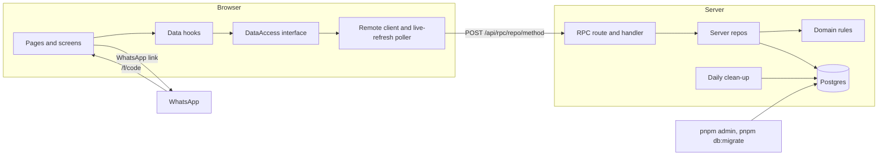
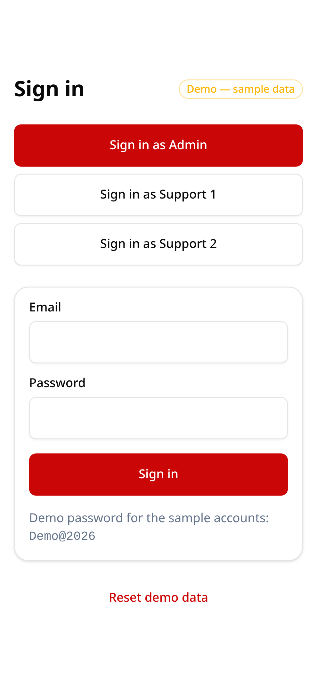

# Chandra Honda · Post-Service Feedback (PSF)

A mobile-first web app that replaces the paper post-service questionnaire for Chandra Honda: support staff create a WhatsApp feedback link from a job card, and the customer answers a short form on their phone. An admin console shows the results.

**Status:** phase 2 (CR-1) is built: sign-in and staff accounts on Postgres, job cards and customer links across branches, the customer form with a privacy notice and `/privacy` page, live refresh, admin overview, alerts, responses, audit log, customer privacy requests (find, download, erase) and the daily clean-up. Questionnaire v2 (CR-2) is built: six steps, a callback question and the new Overview (the preview needs the one-time `clear-feedback` step in [docs/DEPLOY.md](docs/DEPLOY.md)). Going live needs the owner's steps in [docs/PRODUCTION.md](docs/PRODUCTION.md) first; until then, use staff test data only. The owner's guide is [OWNER.md](OWNER.md); a local demo is in [docs/DEMO-SCRIPT.md](docs/DEMO-SCRIPT.md). The phase 1 demo (sample data, kept in the browser) is frozen at https://chandra-psf.vercel.app (presenter steps in [docs/DEMO-GUIDE.md](docs/DEMO-GUIDE.md)). Phase 2 design: [docs/LLD-phase2.md](docs/LLD-phase2.md).

## Architecture

One Next.js app. Screens talk only to the `DataAccess` interface. In the browser that interface sends each call to one RPC route; the server runs the same interface against Postgres (Neon in production, PGlite locally and in tests).



| Module | Responsibility |
|---|---|
| Domain (`src/domain/`) | Pure rules and types: questionnaire v2, show-if logic, alert rules, metrics, roles, password policy, retention |
| Data-access contract (`src/data/access/`) | One typed interface per repo; the screens use only this |
| Remote client (`src/data/remote/`) | Browser side: sends every call to the RPC route; polls staff screens while in use |
| RPC transport (`src/app/api/rpc/`, `src/server/rpc/`) | Same-origin check, method registry, argument checks, session, public flood limit |
| Server core and auth (`src/server/`, `src/server/auth/`) | Request context, role and branch scope, argon2 passwords, database sessions, step-up password |
| Server repos (`src/server/repos/`) | Postgres implementation of each repo; the only route to the database |
| Database (`src/server/db/`, `drizzle/`) | Drizzle schema (one file per table) and the migration |
| Daily clean-up (`src/app/api/cron/daily/`, `src/server/jobs/cleanup.ts`) | Retention erasure, purge of deleted responses, session housekeeping |
| Maintainer scripts (`scripts/`) | `admin.ts` (first admin, one-time passwords, recover, clear-feedback, re-apply erasures), `migrate.ts`, `golive-check.ts` |

Architecture notes: [docs/ARCHITECTURE.md](docs/ARCHITECTURE.md) (as built) and [docs/LLD.md](docs/LLD.md) (numbered design sections, phase 1). Phase 2 design: [docs/LLD-phase2.md](docs/LLD-phase2.md).

## Features

Phase 2 (what runs now):

- **Staff sign-in** with email and password, sessions that end after 2 hours idle for support and 12 hours idle for admins, sign-out, and a lock after repeated wrong passwords. A user with a one-time password sets their own at first sign-in.
- **Support:** look up a job card (case, spaces and dashes ignored) or save a new one, edit the mobile number, generate a link, send it on WhatsApp, copy it, resend or regenerate. Links belong to the branch: **My links** and **All branch links**.
- **Customer form** at `/f/<token>`: six steps, a callback question with a time slot, a privacy notice and the `/privacy` page. Expired, used and invalid links show their own pages.
- **Admin:** overview (KPI tiles, category scores, advisor table), alerts for low ratings and callback requests, responses (edit, delete to Recently deleted, restore), audit log, users, branches, advisors, and customers (search, CSV download, erase, main admin only).
- **Live refresh:** staff screens refresh every 30 seconds while the tab is visible and in use.
- **Daily clean-up:** applies the retention rules, purges deleted responses and clears expired sessions (scheduled by `vercel.json`).

Phase 1 demo (frozen; sample data kept in the browser):

- **Sign-in** with quick buttons for the sample Admin, Support 1 and Support 2 accounts, or email and password.
- **Support, customer form, admin overview, alerts, responses, audit log, users** as in phase 1, with **Reset demo data** on the sign-in screen and a simulated failed save (`?demoFail=1`).

## Screens

Phase 1 demo screens.

| Sign-in (360 px) | New feedback link (360 px) |
|---|---|
|  |  |

| Customer form step (360 px) | Admin overview (1440 px) |
|---|---|
|  |  |

## Tech stack

Next.js 16 (App Router) · React 19 · TypeScript · Tailwind CSS 4 with shadcn/ui · Zod · TanStack Query · Recharts · Drizzle ORM · Neon Postgres (`@neondatabase/serverless`) · PGlite (local Postgres) · argon2 (`@node-rs/argon2`) · Vitest · Playwright · ESLint · Prettier · dependency-cruiser.

Phase 1 kept data in the browser's local storage. Phase 2 keeps data in Postgres.

CI (`.github/workflows/ci.yml`) runs `scripts/check.sh` on every push to `main` and on every pull request, on `ubuntu-24.04` with Node 24 and Node 26. There is no Windows job in CI: the team runs the checks by hand on Windows 11 with Git Bash (see [How to test](#how-to-test)). macOS is not tested.

## Data safety

Phase 2 (production): data lives in a Neon Postgres database, not in the browser.

- **Backup:** Neon's point-in-time restore. The restore window is 7 days once the owner moves Neon to a paid plan (owner checklist step 2 in [docs/PRODUCTION.md](docs/PRODUCTION.md)). Restore steps: [docs/DEPLOY.md](docs/DEPLOY.md) sections 9 and 10.
- **Erasure:** a privacy erasure is logged, so it can be re-applied after a restore (`pnpm admin reapply-erasures`).
- **Retention and erasure rules:** [docs/SPEC.md](docs/SPEC.md) §13 and [docs/PRODUCTION.md](docs/PRODUCTION.md).

Phase 1 demo:

- **No backup.** Nothing is copied to a server.
- **Data lives only in the browser that made it.** Every link, response, alert, user and audit entry stays in that browser until you press **Reset demo data** (or clear the browser's site data).
- **Other devices do not see it.** A phone, a laptop or another browser starts from the sample data and keeps its own copy.
- **Sample data only.** The demo must not hold real customer data. The site asks search engines not to index it.

## How to run

Requirements: Node.js 24 or newer, pnpm 11 (the repo pins `pnpm@11.24.0`; `corepack enable` uses that pin), git. On Windows 11, use Git Bash for the scripts.

Fresh clone to a running app, in order:

```bash
git clone <repository-url> chandra-psf
cd chandra-psf
pnpm install
cp .env.example .env                 # copy it; do not `source` it (some values contain spaces)
git config core.hooksPath .githooks  # once per clone: pre-commit hook
pnpm db:migrate                      # first time only: creates the local database in ./.pglite
pnpm admin init --name "Your Name" --email you@example.com   # first time only: creates the first admin
pnpm dev                             # http://localhost:8000
```

`pnpm admin init` prints the email, a **one-time password** and how long it is valid (72 hours). The password is shown once and never stored in clear: copy it then. If the database already has users, `init` changes nothing and says so. If the one-time password is lost before it is used, `pnpm admin reissue --email <e>` issues a new one (only for a user who has not set a password yet).

First run in the app, before a feedback link can be created:

1. Open http://localhost:8000/sign-in, sign in with the email and the one-time password, and set your own password.
2. **Branches:** add a branch (`/admin/branches`), then open it and add at least one advisor.
3. **Users:** add a support user for that branch (`/admin/users`). They sign in with a temporary password and set their own.
4. Sign out, then sign in as the support user. Under **New feedback link**, look up a job card number; if there is none, use **New job card** to save one, then **Generate link**.

Production-style run (needs a `.env` as above):

```bash
pnpm build && pnpm start             # http://localhost:8000
```

To run on another port, add `-p <port>`, for example `pnpm dev -p <port>` or `pnpm start -p <port>` (the default is 8000). Also set `APP_URL` in `.env` to the same address (for example `http://localhost:8016`): the links the app creates start with `APP_URL`.

Go-live check (production settings, run by the developer before the first real customer link): `pnpm golive:check`. The owner's steps are in [docs/PRODUCTION.md](docs/PRODUCTION.md) and [OWNER.md](OWNER.md).

### Environment keys

Every key the server or the build reads from `.env.example` is listed below (placeholders only in that file). Real values never go into git: locally they go in `.env`, on Vercel in the project's environment variables.

| Key | Needed | What it does | Where the value comes from |
|---|---|---|---|
| `DATABASE_URL` | Always | Database the server uses | Local: `pglite:./.pglite` (from `.env.example`; no account). Preview: the Neon **pooled** URL of the `dev` branch. Never the `production` branch for preview. Under tests it is an in-memory PGlite automatically. Production must not be `pglite:` |
| `DATABASE_URL_UNPOOLED` | Preview and production; leave empty locally | Direct (unpooled) Neon URL, used by `pnpm db:migrate` and `pnpm admin` | Neon console, same `dev` branch, the **direct** connection string |
| `CRON_SECRET` | Production; optional locally | Secret of at least 32 characters. The daily clean-up route `/api/cron/daily` refuses any request without `Authorization: Bearer <CRON_SECRET>` | Generate your own, for example `openssl rand -base64 32`. Never reuse a value across environments |
| `IP_HASH_PEPPER` | Production; optional locally | Secret of at least 32 characters used to hash client IP addresses | Generate your own as above |
| `APP_URL` | Production (https); optional locally | Public address of the app; the feedback links start with it | Local: `http://localhost:8000` (from `.env.example`; match the port you run on). Preview: the `https://` address of the preview deployment, set after its first deploy (see [docs/DEPLOY.md](docs/DEPLOY.md)). Production: the fixed address |
| `AUTH_HASH_TIMING` | Optional | Set to `1` to log how long password hashing takes at sign-in. Leave unset otherwise | You choose it. Not a secret. Used only for the sign-in timing check on preview; unset it afterwards |
| `NEXT_PUBLIC_DEALER_PHONE` | Required in any production build | Dealership phone shown on the customer pages | Placeholder `+91 44 0000 0000` until the dealership gives the real number. Set it in Vercel and redeploy |
| `NEXT_PUBLIC_POLL_SECONDS` | Optional | Live-refresh interval in seconds (default `30`). Missing, non-numeric, zero or negative values fall back to 30 | You choose it. Read by `src/config/env.ts` |
| `NEXT_PUBLIC_COMPANY_NAME`, `NEXT_PUBLIC_PRIVACY_PHONE`, `NEXT_PUBLIC_PRIVACY_EMAIL` | Replace before go-live | Company name and privacy contact, shown on the feedback notice and `/privacy`. Missing values fall back to placeholders | From the dealership (owner checklist step 4 in [docs/PRODUCTION.md](docs/PRODUCTION.md)). Read by `src/config/env.ts` |

Keys the app reads that are **not** in `.env.example`:

- `PUBLIC_FLOOD_LIMIT_OVERRIDE`: end-to-end tests only. `playwright.config.ts` sets it to 100000 so the browser tests do not hit the per-address limit. Read by `src/server/env.ts`. It is ignored when `VERCEL_ENV=production`, and when `NODE_ENV=production` on any database other than PGlite. Leave it unset.
- `NEXT_PUBLIC_DEMO_PASSWORD`: phase 1 demo only (the frozen `chandra-psf` project); see [docs/DEPLOY.md](docs/DEPLOY.md).

Set by the platform, do not set them yourself: `NODE_ENV` (Next.js and the test runner) and `VERCEL_ENV` (Vercel).

Deployment to Vercel (environment variables, the preview checklist, redeploy, roll back): [docs/DEPLOY.md](docs/DEPLOY.md).

gitleaks: `scripts/check.sh` looks for the binary on the PATH, then at `~/.cache/chandra-psf/tools/gitleaks`, then at `.tools/gitleaks` in the project. It does not download gitleaks; install it yourself.

## How to test

```bash
scripts/check.sh                          # every gate in scripts/check.sh: lint, format, types, layers, migrations in sync, unit tests with coverage, build, end-to-end, secrets
CHECK_NO_COVERAGE=1 scripts/check.sh      # same, without the coverage threshold
pnpm test                                 # unit tests (Vitest); database tests use in-memory PGlite, no Neon needed
pnpm build && pnpm test:e2e               # browser tests (Playwright, 360 px and 1440 px); they run the built app
pnpm exec vitest run tests/unit/server/users/createUser.test.ts   # one unit test file
pnpm exec playwright test tests/e2e/admin-users                   # one browser test folder (after pnpm build)
PORT=8016 scripts/check.sh                # use another port when another server runs on 8000
```

The first run needs the Chromium browser for Playwright: `pnpm exec playwright install chromium`. On Arch Linux, prefix it with `PLAYWRIGHT_HOST_PLATFORM_OVERRIDE=ubuntu24.04-x64`.

**Windows 11:** use Git Bash (the scripts are bash). Before `scripts/check.sh`, run this in the same shell:

```bash
export PLAYWRIGHT_HOST_PLATFORM_OVERRIDE=win64 NODE_OPTIONS=--max-old-space-size=4096
```

`scripts/check.sh` otherwise assumes the Ubuntu Playwright browsers, and Vitest can run out of memory without the larger heap. Put gitleaks on the PATH, or at `~/.cache/chandra-psf/tools/gitleaks` (the name `check.sh` looks for).

## How to extend

Full guide with the files to touch for each change: [docs/WALKTHROUGH.md](docs/WALKTHROUGH.md) §4. Start with its §1 reading list.

- **Add an admin screen:** create `src/features/admin-<name>/` with the screen and its hook, add a route at `src/app/admin/<name>/page.tsx` that renders it, and add one entry to `ADMIN_NAV` in `src/components/shared/adminNav.ts`. Copy `src/features/admin-users/` and `src/app/admin/users/page.tsx`.
- **Add a repo method:** declare it in the interface in `src/data/access/repos/<name>.ts`; implement it in `src/server/repos/<name>.ts`, starting with a role check (`requireAdmin` or `requireStaff`) and filtering by branch scope (`branchFilter`, `src/server/scope.ts`), with `writeAudit` (`src/server/audit.ts`) for writes; add its entry to the method registry in `src/server/rpc/<name>.ts` (listed in `src/server/rpc/index.ts`). The browser side is a proxy per repo, so it needs no new code. Copy `setUserActive` in `src/server/repos/users.ts` and `src/server/rpc/users.ts`. Rules: [docs/CONVENTIONS.md](docs/CONVENTIONS.md) §2 and [docs/LLD-phase2.md](docs/LLD-phase2.md) §17.
- **Change the database:** edit the schema in `src/server/db/schema/`, run `pnpm db:generate`, and commit the new file in `drizzle/`. `scripts/check.sh` fails if the schema and the migrations differ.
- Feature folders may not import each other, and only `src/server` may import the database. The layer rules in `.dependency-cruiser.cjs` enforce this; `scripts/check.sh` runs them.

## Project structure

```
src/
  app/            routes only: admin/, support/, f/[token]/, account/, privacy/, sign-in/,
                  api/rpc/ (the one RPC route), api/cron/daily/ (daily clean-up)
  features/       one folder per screen area: auth, account, support, feedback-form, privacy,
                  admin-overview, admin-alerts, admin-responses, admin-audit, admin-users,
                  admin-branches, admin-customers
  components/     ui/ (shadcn/ui components) and shared/ (AdminShell, RoleGuard, adminNav.ts, ...)
  hooks/          data hooks (useRepoQuery, useRepoMutation, useLiveInvalidation, useSession, ...)
  data/access/    DataAccess interface and one interface per repo (the contract)
  data/remote/    browser client: sends each call to the RPC route; live-refresh poller
  domain/         pure rules and types (questionnaire, visibility, alert rules, metrics, retention)
  server/         Postgres side: rpc/ (method registry), repos/ (one per repo), auth/, db/ (Drizzle
                  schema), jobs/ (daily clean-up), and the core files (ctx.ts, scope.ts, audit.ts, env.ts)
  proxy.ts        security headers, Content Security Policy, sign-in redirect
  config/env.ts  public settings (NEXT_PUBLIC_ variables)
drizzle/        database migrations (committed)
scripts/        check.sh, migrate.ts, admin.ts (first admin, reissue, recover, clear-feedback,
                reapply-erasures), adminClear.ts, golive-check.ts
tests/          unit/ (Vitest), e2e/ (Playwright), support/ (shared test helpers)
docs/           specification, design, architecture, walkthrough, deployment, production gate, demo guides
```

## Documentation

- `docs/SPEC.md`: what the product does (user stories, flows, data safety in §13)
- `docs/ARCHITECTURE.md`: what was built, with the deviations from the plan
- `docs/LLD.md`: how phase 1 is built (numbered sections)
- `docs/LLD-phase2.md`: how phase 2 is built (server, auth, database, deployment); as-built notes are tagged per section
- `docs/WALKTHROUGH.md`: guided code tour and how to extend
- `docs/DEPLOY.md`: publishing to Vercel, the phase 2 preview checklist, the production steps, restore
- `docs/PRODUCTION.md`: production-readiness gate checklist: each item is built and tested, open, or an owner step
- `docs/DEMO-GUIDE.md`: presenter guide for the phase 1 demo
- `docs/DEMO-SCRIPT.md`: running a local phase 2 demo alone, step by step
- `docs/CONVENTIONS.md`: code rules and checks
- `OWNER.md`: one-page guide for the owner (no code)
