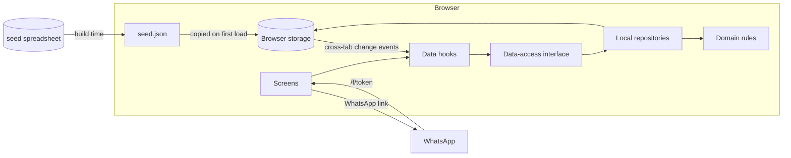
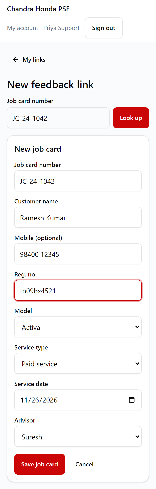
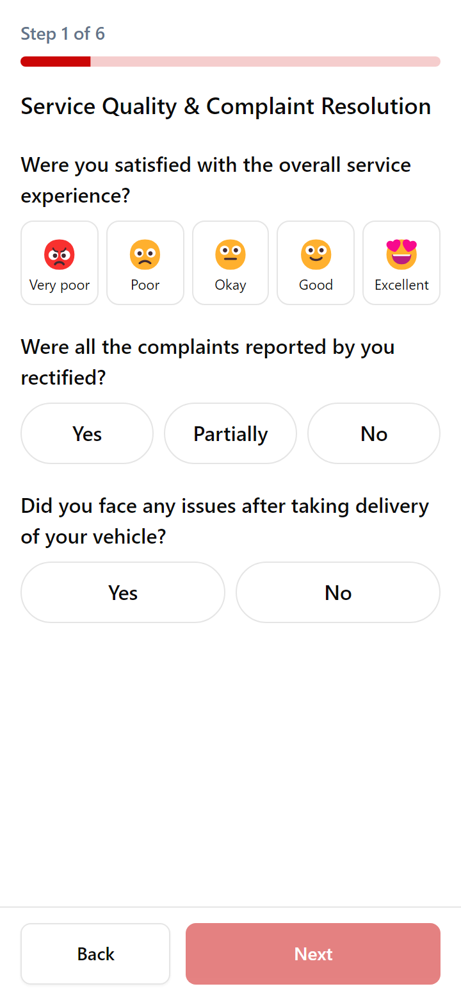
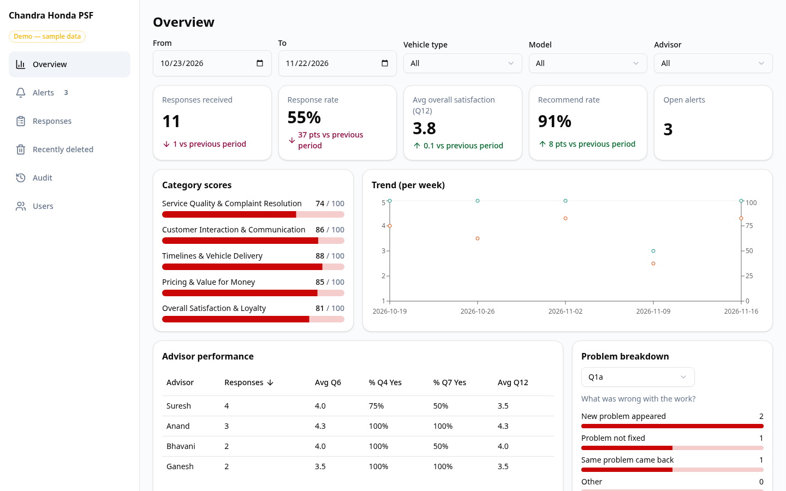

# Chandra Honda · Post-Service Feedback (PSF)

A mobile-first web app that replaces the paper post-service questionnaire for Chandra Honda: support staff create a WhatsApp feedback link from a job card, and the customer answers a short form on their phone. An admin console shows the results.

**Status:** phase 2, milestone M4 built: the support → customer loop works across devices. Support staff create job cards and generate, send, resend, regenerate or cancel customer links (any support user at the branch can act on the branch's links). The customer form works on any phone and shows a privacy notice with a `/privacy` page. Screens refresh live while staff use them (`NEXT_PUBLIC_POLL_SECONDS`, default 30). The alerts queue is per branch. Still to come in M5: analytics, responses and audit on the server, privacy requests and erasure, daily clean-up, and production. The phase 1 demo (sample data, kept in the browser) is frozen at https://chandra-psf.vercel.app (presenter steps in [docs/DEMO-GUIDE.md](docs/DEMO-GUIDE.md)). Phase 2 design: [docs/LLD-phase2.md](docs/LLD-phase2.md).

## Architecture

The diagram below shows the phase 1 demo (browser only). Phase 2 adds a server and a Postgres database behind the same data-access contract; its design is in [docs/LLD-phase2.md](docs/LLD-phase2.md).



| Module | Responsibility |
|---|---|
| Domain | Pure rules: questionnaire and show/hide logic, alert rules, metrics, phone, job card and WhatsApp helpers |
| Data-access contract | One typed interface the screens use; phase 2 swaps only its implementation |
| Local store (phase 1) | Browser storage with cross-tab locking and change events; simulated failed save |
| Seed pipeline | Builds the sample data fixture; dates move to "today" on load |
| Screens | Sign-in, support (job card lookup, links), customer form, admin console (overview, alerts, responses, audit, users) |
| Server (phase 2) | Sign-in and sessions, password hashing (argon2), RPC endpoint, rate limits, audit, repositories on Postgres; security headers and CSP in `src/proxy.ts` |
| Database (phase 2) | Drizzle schema and migrations (`scripts/migrate.ts`); PGlite locally, Neon Postgres in preview |
| Admin CLI (phase 2) | `scripts/admin.ts`: creates the first admin, reissues one-time passwords, recovers the main admin |

Architecture notes: [docs/ARCHITECTURE.md](docs/ARCHITECTURE.md) (as built) and [docs/LLD.md](docs/LLD.md) (numbered design sections, phase 1). Phase 2: [docs/LLD-phase2.md](docs/LLD-phase2.md).

## Features (phase 1 demo, what runs there)

The list below describes the frozen phase 1 demo. Phase 2 features are tracked in [docs/LLD-phase2.md](docs/LLD-phase2.md).

- **Sign-in** with quick buttons for the sample Admin, Support 1 and Support 2 accounts, or email and password. A user with a temporary password sets their own at first sign-in.
- **Support:** look up a job card (case, spaces and dashes ignored), see the customer and vehicle details, edit the mobile number, generate a link, send it on WhatsApp, copy it, search links, resend, regenerate or cancel.
- **Customer form** at `/f/<token>`: personal welcome, five category steps with follow-up questions, callback question, thank-you page. Answers are restored after a refresh. Expired, already-submitted and invalid links show their own pages.
- **Admin overview:** five KPI tiles with change arrows, seven analytics blocks, and filters (date range, vehicle type, model, advisor) that stay in the address bar. Empty results show "—", never 0 % or NaN.
- **Alerts:** created when a submission has a rating of 1 or asks for a callback. Filter by Open, Contacted or Resolved, add notes, and see the open count on the navigation badge.
- **Responses:** list and detail. Edit an answer, delete a response (moved to Recently deleted) or restore it. Edit, delete and restore ask for the admin password.
- **Audit log:** every link, response, alert and user change, newest first, filterable by action.
- **Users:** add a support user, deactivate and reactivate users.
- **Two tabs of one browser** stay in step: a change in one tab shows in the other without a reload.
- **Reset demo data** on the sign-in screen restores the sample data.
- **Simulated failed save** (admin sidebar or More menu, or `?demoFail=1` in the address) makes the next save in that tab fail once, showing "Couldn't save, try again".

## Screens

Phase 1 demo screens.

| Sign-in (360 px) | New feedback link (360 px) |
|---|---|
|  |  |

| Customer form step (360 px) | Admin overview (1440 px) |
|---|---|
|  |  |

## Tech stack

Next.js 16 (App Router) · React 19 · TypeScript · Tailwind CSS 4 with shadcn/ui · Zod · TanStack Query · Recharts · Drizzle ORM · Neon Postgres (`@neondatabase/serverless`) · PGlite (local Postgres) · argon2 (`@node-rs/argon2`) · Vitest · Playwright · ESLint · Prettier · dependency-cruiser.

Phase 1 kept data in the browser's local storage. Phase 2 keeps data in Postgres.

CI runs on GitHub Actions, `ubuntu-24.04`, with Node 24 and Node 26. The team also runs the checks on Windows 11 with Git Bash (see [How to test](#how-to-test)). macOS is not tested.

## Data safety

Phase 1 demo:

- **No backup.** Nothing is copied to a server.
- **Data lives only in the browser that made it.** Every link, response, alert, user and audit entry stays in that browser until you press **Reset demo data** (or clear the browser's site data).
- **Other devices do not see it.** A phone, a laptop or another browser starts from the sample data and keeps its own copy.
- **Sample data only.** The demo must not hold real customer data. The site asks search engines not to index it.

Phase 2: data lives in a Neon Postgres database, not in the browser. The data-safety rules (retention, erasure, backups) are in [docs/SPEC.md](docs/SPEC.md) §13 and [docs/PRODUCTION.md](docs/PRODUCTION.md).

## How to run

Requirements: Node.js 24 or newer, pnpm 11, git.

```bash
git clone <repository-url> chandra-psf
cd chandra-psf
pnpm install
cp .env.example .env                 # the app reads its settings from .env
git config core.hooksPath .githooks  # once per clone: pre-commit hook
pnpm db:migrate                      # first time only: creates the local database in ./.pglite
pnpm admin init --name "Your Name" --email you@example.com   # first time only: creates the first admin
pnpm dev                             # http://localhost:8000
```

`pnpm admin init` prints the email, a **one-time password** and how long it is valid (72 hours). The password is shown once and never stored in clear: copy it then. Open http://localhost:8000 and sign in with that email and password; you are asked to set your own password at first sign-in. If the database already has users, `init` changes nothing and says so. If the one-time password is lost before it is used, `pnpm admin reissue --email <e>` issues a new one (only for a user who has not set a password yet).

Production-style run (needs a `.env` as above):

```bash
pnpm build && pnpm start             # http://localhost:8000
```

To run on another port, add `-p <port>`, for example `pnpm dev -p <port>` or `pnpm start -p <port>` (the default is 8000).

### Environment keys

Every key the server or the build reads is in `.env.example` (placeholders only). Real values never go into git: locally they go in `.env`, on Vercel in the project's environment variables. Keys that are not in `.env.example` are listed in the last table.

| Key | Needed | What it does | Where the value comes from |
|---|---|---|---|
| `DATABASE_URL` | Always | Database the server uses | Local: `pglite:./.pglite` (from `.env.example`; no account). Preview: the Neon **pooled** URL of the `dev` branch. Never the `production` branch for preview. Under tests it is an in-memory PGlite automatically. Production must not be `pglite:` |
| `DATABASE_URL_UNPOOLED` | Preview and production; leave empty locally | Direct (unpooled) Neon URL, used by `pnpm db:migrate` and `pnpm admin` | Neon console, same `dev` branch, the **direct** connection string |
| `CRON_SECRET` | Production; optional locally | Secret of at least 32 characters. The scheduled retention job that uses it is not built yet (LLD-phase2 §25) | Generate your own, for example `openssl rand -base64 32`. Never reuse a value across environments |
| `IP_HASH_PEPPER` | Production; optional locally | Secret of at least 32 characters used to hash client IP addresses | Generate your own as above |
| `APP_URL` | Production (https); optional locally | Public address of the app | Local: `http://localhost:8000` (from `.env.example`). Preview: the `https://` address of the preview deployment, set after its first deploy (see [docs/DEPLOY.md](docs/DEPLOY.md)). Production: the fixed address |
| `AUTH_HASH_TIMING` | Optional | Set to `1` to log how long password hashing takes at sign-in. Leave unset otherwise | You choose it. Not a secret. Used only for the sign-in timing check on preview; unset it afterwards |
| `NEXT_PUBLIC_DEALER_PHONE` | Required in any production build | Dealership phone shown on the customer pages | Placeholder `+91 44 0000 0000` until the dealership gives the real number. Set it in Vercel and redeploy |

Other public settings in `.env.example`:

- `NEXT_PUBLIC_POLL_SECONDS`: live-refresh interval in seconds (default `30`). Missing, non-numeric or zero or negative values fall back to 30. Read by `src/config/env.ts`.
- `NEXT_PUBLIC_COMPANY_NAME`, `NEXT_PUBLIC_PRIVACY_PHONE`, `NEXT_PUBLIC_PRIVACY_EMAIL`: company name and privacy contact. Read by `src/config/env.ts` and shown on the feedback notice and /privacy. Missing values fall back to placeholders until the dealership supplies the real ones.

Set by the platform, do not set them yourself: `NODE_ENV` (Next.js and the test runner) and `VERCEL_ENV` (Vercel).

Phase 1 demo only (the frozen chandra-psf project): `NEXT_PUBLIC_DEMO_PASSWORD`, the password of the sample accounts. It is no longer in `.env.example`; see [docs/DEPLOY.md](docs/DEPLOY.md).

Deployment to Vercel (environment variables, the preview checklist, redeploy, roll back): [docs/DEPLOY.md](docs/DEPLOY.md).

gitleaks: `scripts/check.sh` looks for the binary on the PATH, then at `~/.cache/chandra-psf/tools/gitleaks`, then at the gitleaks binary under .tools (downloaded on first run).

## How to test

```bash
scripts/check.sh                          # every gate in scripts/check.sh: lint, format, types, layers, unit tests with coverage, build, end-to-end, secrets
CHECK_NO_COVERAGE=1 scripts/check.sh      # same, without the coverage threshold
pnpm test                                 # unit tests (Vitest); database tests use in-memory PGlite, no Neon needed
pnpm build && pnpm test:e2e               # browser tests (Playwright, 360 px and 1440 px); they run the built app
pnpm exec vitest run tests/unit/admin-users/usersRepo.test.ts   # one unit test file
PORT=8016 scripts/check.sh                # use another port when another server runs on 8000
```

The first run needs the Chromium browser for Playwright: `pnpm exec playwright install chromium`. On Arch Linux, prefix it with `PLAYWRIGHT_HOST_PLATFORM_OVERRIDE=ubuntu24.04-x64`.

**Windows:** use Git Bash (the scripts are bash). Before `scripts/check.sh`, run this in the same shell:

```bash
export PLAYWRIGHT_HOST_PLATFORM_OVERRIDE=win64 NODE_OPTIONS=--max-old-space-size=4096
```

`scripts/check.sh` otherwise assumes the Ubuntu Playwright browsers, and Vitest can run out of memory without the larger heap. Put gitleaks at `~/.cache/chandra-psf/tools/gitleaks.exe` (or `gitleaks` on the PATH).

CI runs `scripts/check.sh` on every push and pull request (`.github/workflows/ci.yml`).

## How to extend

Full guide with the files to touch for each change: [docs/WALKTHROUGH.md](docs/WALKTHROUGH.md) §4.

- **Add an admin screen:** create `src/features/admin-<name>/` with the screen and its hook, add a route at `src/app/admin/<name>/page.tsx` that renders it, and add one entry to `ADMIN_NAV` in `src/components/shared/adminNav.ts`. Copy `src/features/admin-users/` and `src/app/admin/users/page.tsx`.
- **Add a repo method:** declare it in the interface in `src/data/access/repos/<name>.ts`, implement it in the class in `src/data/local/repos/<name>.ts` (use `guardRead` or `guardWrite`, `store.mutate`, and `appendAudit` for writes). Copy `setUserActive` in `src/data/local/repos/users.ts`. Phase 2 server repositories follow the rules in [docs/LLD-phase2.md](docs/LLD-phase2.md) §17.
- Feature folders may not import each other or `src/data/local`; `scripts/check.sh` enforces this.

## Project structure

```
src/
  app/            routes only; each page renders one screen (admin/, support/, f/[token]/)
  features/       screens per area: auth, support, feedback-form, admin-overview,
                  admin-alerts, admin-responses, admin-audit, admin-users, account
  components/     shadcn/ui components and shared components (AdminShell, RoleGuard, ...)
  hooks/          data hooks (useRepoQuery, useRepoMutation, useSession, ...)
  data/access/    data-access interface (the contract)
  data/local/     phase 1 browser-storage implementation and repositories
  data/remote/    phase 2 client that calls the server
  data/seed/      sample-data fixture (generated)
  domain/         pure rules and types (alerts, metrics, questionnaire, phone, WhatsApp)
  server/         phase 2: RPC endpoint, auth and sessions, repositories, db schema and client, env
  proxy.ts        security headers and the Content Security Policy
  config/env.ts   public environment settings
scripts/          check.sh, build-seed.ts, migrate.ts, admin.ts (first admin, one-time passwords)
tests/            unit (Vitest) and end-to-end (Playwright) tests
docs/             specification, design, architecture, walkthrough, deployment, demo guide
```

## Documentation

- `docs/SPEC.md`: what the product does (user stories, flows, data safety in §13)
- `docs/ARCHITECTURE.md`: what was built, with the deviations from the plan
- `docs/LLD.md`: how phase 1 is built (numbered sections)
- `docs/LLD-phase2.md`: how phase 2 is built (server, auth, database, deployment); as-built notes are tagged per section
- `docs/WALKTHROUGH.md`: guided code tour and how to extend
- `docs/DEPLOY.md`: publishing to Vercel, and the phase 2 preview checklist
- `docs/PRODUCTION.md`: production-readiness gate checklist: each item is built and tested, waived by the owner, or not applicable
- `docs/DEMO-GUIDE.md`: presenter guide
- `docs/CONVENTIONS.md`: code rules and checks
- `OWNER.md`: one-page guide for the owner (no code)
