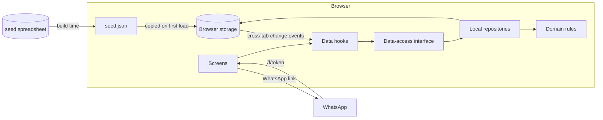

# Chandra Honda · Post-Service Feedback (PSF)

A mobile-first web app that replaces the paper post-service questionnaire for Chandra Honda: support staff create a WhatsApp feedback link from a job card, and the customer answers a short form on their phone. An admin console shows the results.

**Status:** phase 1 demo on sample data. The support-to-customer loop and the admin console (overview, alerts, responses with edit, delete and restore, audit log, users) are built. Data lives in each browser; there is no server or database yet.

**Live demo:** https://chandra-psf.vercel.app (presenter steps in [docs/DEMO-GUIDE.md](docs/DEMO-GUIDE.md)).

## Architecture



| Module | Responsibility |
|---|---|
| Domain | Pure rules: questionnaire and show/hide logic, alert rules, metrics, phone, job card and WhatsApp helpers |
| Data-access contract | One typed interface the screens use; phase 2 swaps only its implementation |
| Local store | Browser storage with cross-tab locking and change events; simulated failed save |
| Seed pipeline | Builds the sample data fixture; dates move to "today" on load |
| Screens | Sign-in, support (job card lookup, links), customer form, admin console (overview, alerts, responses, audit, users) |

Architecture notes: [docs/ARCHITECTURE.md](docs/ARCHITECTURE.md) (as built) and [docs/LLD.md](docs/LLD.md) (numbered design sections).

## Features (what runs now)

- **Sign-in** with quick buttons for the sample Admin, Support 1 and Support 2 accounts, or email and password. A user with a temporary password sets their own at first sign-in.
- **Support:** look up a job card (case, spaces and dashes ignored), see the customer and vehicle details, edit the mobile number, generate a link, send it on WhatsApp, copy it, search links, resend, regenerate or cancel.
- **Customer form** at `/f/<token>`: personal welcome, five category steps with follow-up questions, callback question, thank-you page. Answers are restored after a refresh. Expired, already-submitted and invalid links show their own pages.
- **Admin overview:** five KPI tiles with change arrows, seven analytics blocks, and filters (date range, vehicle type, model, advisor) that stay in the address bar. Empty results show "—", never 0 % or NaN.
- **Alerts:** created when a submission has a rating of 1 or asks for a callback. Filter by Open, Contacted or Resolved, add notes, and see the open count on the navigation badge.
- **Responses:** list and detail. Edit an answer, delete a response (moved to Recently deleted) or restore it. Edit, delete and restore ask for the admin password.
- **Audit log:** every link, response, alert and user change, newest first, filterable by action.
- **Users:** add a support user, deactivate and reactivate users.
- **Two tabs of one browser** stay in step: a change in one tab shows in the other without a reload.
- **Reset demo data** on the sign-in screen restores the sample data.
- **Simulated failed save** (admin sidebar or More menu, or `?demoFail=1` in the address) makes the next save in that tab fail once, showing "Couldn't save, try again".

## Screens

| Sign-in (360 px) | New feedback link (360 px) |
|---|---|
|  |  |

| Customer form step (360 px) | Admin overview (1440 px) |
|---|---|
|  |  |

## Tech stack

Next.js 16 (App Router) · React 19 · TypeScript · Tailwind CSS 4 with shadcn/ui · Zod · TanStack Query · Recharts · Vitest · Playwright · ESLint · Prettier · dependency-cruiser. Data is kept in the browser's local storage; there is no database in phase 1.

Tested on Linux only: CI runs on GitHub Actions, `ubuntu-24.04`, with Node 24 and Node 26. macOS and Windows are not tested.

## Data safety

- **No backup.** Nothing is copied to a server.
- **Data lives only in the browser that made it.** Every link, response, alert, user and audit entry stays in that browser until you press **Reset demo data** (or clear the browser's site data).
- **Other devices do not see it.** A phone, a laptop or another browser starts from the sample data and keeps its own copy. A link opened on another device shows the welcome page, but the answers stay on that device.
- **Sample data only.** The demo must not hold real customer data. The site asks search engines not to index it.

## How to run

Requirements: Node.js 24 or newer, pnpm 11, git.

```bash
git clone <repository-url> chandra-psf
cd chandra-psf
pnpm install
cp .env.example .env                 # needed for pnpm build and pnpm start (see below)
git config core.hooksPath .githooks  # once per clone: pre-commit hook
pnpm dev                             # http://localhost:8000
```

`pnpm dev` also works without a .env file: the app then uses the sample values from `.env.example`. `pnpm build` and `pnpm start` need the three keys below, so copy `.env.example` to a new file named .env first. Production-style run:

```bash
pnpm build && pnpm start             # http://localhost:8000
```

To run on another port, add `-p <port>`, for example `pnpm dev -p <port>` or `pnpm start -p <port>` (the default is 8000).

Environment keys (all listed in `.env.example`; none is a secret, and none should be committed with a real value):

| Key | What it does | Where the value comes from |
|---|---|---|
| `NEXT_PUBLIC_DEMO_PASSWORD` | Password of the sample accounts, shown on the sign-in screen by design | The sample value in `.env.example` (`Demo@2026`) |
| `NEXT_PUBLIC_DEALER_PHONE` | Dealership phone on the link pages | Placeholder `+91 44 0000 0000` until the dealership's real number is set (in the hosting settings, see `docs/DEPLOY.md`) |
| `NEXT_PUBLIC_APP_URL` | Public address used in links | Optional, empty by default. Links use the address the page itself is opened on (local, Vercel preview or production). Set it only if links must point at a fixed public address, such as a custom domain |

Sign in with one of the sample accounts (admin@chandrahonda.demo, support1@chandrahonda.demo, support2@chandrahonda.demo) and the demo password. Presenter steps are in [docs/DEMO-GUIDE.md](docs/DEMO-GUIDE.md).

Deployment to Vercel (environment variables, redeploy, roll back): [docs/DEPLOY.md](docs/DEPLOY.md).

gitleaks: `scripts/check.sh` looks for the binary on the PATH, then at `~/.cache/chandra-psf/tools/gitleaks`, then at the gitleaks binary under .tools (downloaded on first run).

## How to test

```bash
scripts/check.sh                          # every gate: lint, format, types, layers, unit tests with coverage, seed, build, end-to-end, secrets
CHECK_NO_COVERAGE=1 scripts/check.sh      # same, without the coverage threshold
pnpm test                                 # unit tests (Vitest)
pnpm build && pnpm test:e2e               # browser tests (Playwright, 360 px and 1440 px); they run the built app
pnpm exec vitest run tests/unit/admin-users/usersRepo.test.ts   # one unit test file
PORT=8016 scripts/check.sh                # use another port when another server runs on 8000
```

The first run needs the Chromium browser for Playwright: `pnpm exec playwright install chromium`. On Arch Linux, prefix it with `PLAYWRIGHT_HOST_PLATFORM_OVERRIDE=ubuntu24.04-x64`.

CI runs `scripts/check.sh` on every push and pull request (`.github/workflows/ci.yml`).

## How to extend

Full guide with the files to touch for each change: [docs/WALKTHROUGH.md](docs/WALKTHROUGH.md) §4.

- **Add an admin screen:** create `src/features/admin-<name>/` with the screen and its hook, add a route at `src/app/admin/<name>/page.tsx` that renders it, and add one entry to `ADMIN_NAV` in `src/components/shared/adminNav.ts`. Copy `src/features/admin-users/` and `src/app/admin/users/page.tsx`.
- **Add a repo method:** declare it in the interface in `src/data/access/repos/<name>.ts`, implement it in the class in `src/data/local/repos/<name>.ts` (use `guardRead` or `guardWrite`, `store.mutate`, and `appendAudit` for writes). Copy `setUserActive` in `src/data/local/repos/users.ts`.
- Feature folders may not import each other or `src/data/local`; `scripts/check.sh` enforces this.

## Project structure

```
src/
  app/            routes only; each page renders one screen (admin/, support/, f/[token]/)
  features/       screens per area: auth, support, feedback-form, admin-overview,
                  admin-alerts, admin-responses, admin-audit, admin-users
  components/     shadcn/ui components and shared components (AdminShell, RoleGuard, ...)
  hooks/          data hooks (useRepoQuery, useRepoMutation, useSession, ...)
  data/access/    data-access interface (the contract)
  data/local/     browser-storage implementation and repositories
  data/seed/      sample-data fixture (generated)
  domain/         pure rules and types (alerts, metrics, questionnaire, phone, WhatsApp)
  config/env.ts   environment settings
scripts/          check.sh, build-seed.ts, seed/ (sample-data rules)
tests/            unit (Vitest) and end-to-end (Playwright) tests
docs/             specification, design, architecture, walkthrough, deployment, demo guide
```

## Documentation

- `docs/SPEC.md`: what the product does (user stories, flows, data safety in §13)
- `docs/ARCHITECTURE.md`: what was built, with the deviations from the plan
- `docs/LLD.md`: how it is built (numbered sections)
- `docs/WALKTHROUGH.md`: guided code tour and how to extend
- `docs/DEPLOY.md`: publishing to Vercel
- `docs/PRODUCTION.md`: production-readiness gate checklist: each item is built and tested, waived by the owner, or not applicable
- `docs/DEMO-GUIDE.md`: presenter guide
- `docs/CONVENTIONS.md`: code rules and checks
- `OWNER.md`: one-page guide for the owner (no code)
