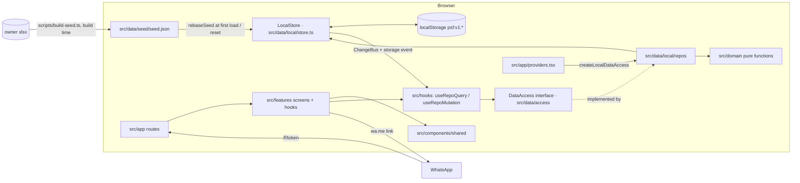
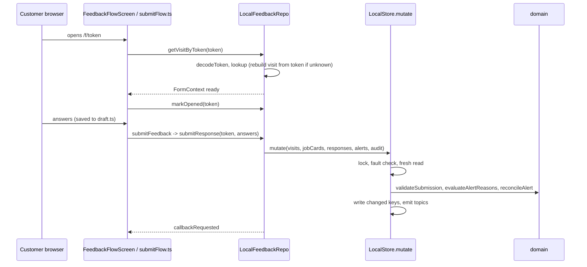
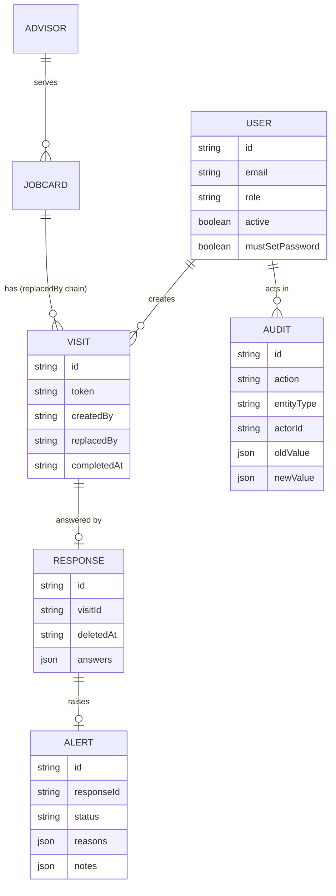

# Architecture (as built) — Chandra Honda PSF phase 1 demo

> Final, as-built description written at handover, from the code, not from the original plan. Deviations from the plan are listed in §7. Section numbers like "LLD §5" point at `docs/LLD.md`, which is synced to the same code.

## 1. What it is
A clickable demo of a post-service feedback system for a Honda dealership. Support staff look up a job card and send the customer a WhatsApp link; the customer answers a short phone form; an admin console shows overview metrics, an alert queue for unhappy or callback-requesting customers, editable and deletable responses, an audit log and user management. It is one Next.js app with no server: all data lives in the browser's localStorage, seeded from an owner-supplied spreadsheet. The data layer sits behind an interface (`src/data/access/index.ts`) so phase 2 can swap in a real backend without touching screens.

## 2. System diagram


## 3. Components
| Component | Path | Responsibility | Depends on |
|---|---|---|---|
| Domain | `src/domain/` | Types and zod schemas, questionnaire config, show-if engine (`src/domain/visibility.ts`), alert rules (`src/domain/alertRules.ts`), metrics (`src/domain/metrics/overview.ts`), phone/WhatsApp/job-card helpers, IST time | zod only |
| Data-access contract | `src/data/access/` | `DataAccess` and one interface per repo (`repos/*.ts`), `Result`/`ErrorCode`, `DataAccessProvider` | domain types |
| Data hooks | `src/hooks/` | `useRepoQuery`, `useRepoMutation`, `useLiveInvalidation`, `useSession`, `useOpenAlertCount`, `useShellActions`, `useFiltersFromUrl` | data/access |
| Local store | `src/data/local/store.ts` (+ `src/data/local/db.ts`, `src/data/local/bus.ts`, `src/data/local/fault.ts`, `src/data/local/crypto.ts`) | localStorage collections, Web Locks write path, change bus, simulated failed save, password hash | domain schemas |
| Seed | `scripts/build-seed.ts`, `src/data/local/seed.ts` | Spreadsheet → JSON fixture at build time; `rebaseSeed` moves dates to "today" at runtime | domain |
| Local repositories | `src/data/local/repos/` | Phase 1 implementation of every interface; role checks, audit writes, alert reconciliation | store, domain, access |
| Composition root | `src/data/local/createLocalDataAccess.ts`, `src/app/providers.tsx` | Wires bus, fault switch, store, repos; the only importer of `src/data/local/` | all of the above |
| App shell | `src/app/*/layout.tsx`, `src/components/shared/` | `RoleGuard`, `AdminShell`, `SupportShell`, dialogs, `SaveState`, `FilterBar` | hooks |
| Auth | `src/features/auth/` | Sign-in, set-password, landing path | hooks |
| Support | `src/features/support/` | Own-link list, job-card lookup, generate/send/regenerate/cancel | hooks |
| Feedback form | `src/features/feedback-form/` | Token link states, step machine, field registry, draft, submit outcomes | hooks |
| Admin overview | `src/features/admin-overview/` | Filters, KPI tiles, charts, advisor table, comments | hooks |
| Admin alerts | `src/features/admin-alerts/` | Alert queue, drawer, status and notes | hooks |
| Admin responses | `src/features/admin-responses/` | List, detail, edit/delete with step-up password, recently deleted | hooks |
| Admin audit | `src/features/admin-audit/` | Append-only audit list with action filter | hooks |
| Admin users | `src/features/admin-users/` | Add support user, deactivate/reactivate | hooks |

## 4. Key flows (as implemented)

### A. Customer submits feedback (S-12, S-13, F-4)

Files involved, in order: `src/app/f/[token]/page.tsx` → `src/features/feedback-form/FeedbackFormScreen.tsx` → `src/features/feedback-form/useFormContext.ts` → `src/data/local/repos/feedback.ts` (+ `src/data/local/repos/token.ts`) → `src/features/feedback-form/FeedbackFlowScreen.tsx` → `src/features/feedback-form/useFeedbackFlow.ts` → `src/features/feedback-form/formMachine.ts` / `src/features/feedback-form/draft.ts` → `src/features/feedback-form/submitFlow.ts` → `src/data/local/repos/feedback.ts` `submitResponse` → `src/data/local/store.ts` `mutate` → `src/domain/visibility.ts`, `src/domain/alertRules.ts`.

### B. Admin edits a response (D-07, D-16)
```mermaid
sequenceDiagram
  participant U as ResponseDetailView
  participant H as useResponseEditor
  participant R as LocalResponseRepo
  participant ST as LocalStore.mutate
  U->>H: start, setAnswer, save(password)
  H->>R: editResponse(id, answers, StepUp)
  R->>R: admin check, hashPassword
  R->>ST: mutate(responses, alerts, ..., users, audit)
  ST->>R: draft; compare password hash (BAD_PASSWORD)
  R->>R: validateSubmission, diffAnswers, appendAudit response.edit
  R->>R: reconcileAlert -> create / auto-resolve / update reasons
  ST-->>R: write + emit alerts, responses
  R-->>H: ResponseDetail
```
Files involved, in order: `src/features/admin-responses/ResponseDetailView.tsx` → `src/features/admin-responses/useResponseEditor.ts` → `src/hooks/useRepoMutation.ts` → `src/data/local/repos/responses.ts` (`editResponse`, `write`, `reconcile`) → `src/data/local/repos/auditWriter.ts` → `src/domain/alertRules.ts`. The change bus then invalidates queries (`src/hooks/useLiveInvalidation.ts`), so the alert badge (`src/hooks/useOpenAlertCount.ts`) and Overview refresh.

### C. Overview metrics (S-09, S-10, S-11)
Files involved, in order: `src/app/admin/page.tsx` → `src/features/admin-overview/AdminOverviewScreen.tsx` → `src/features/admin-overview/useOverview.ts` (filters via `src/hooks/useFiltersFromUrl.ts`) → `src/data/local/repos/analytics.ts` (`getAnalytics` builds `AnalyticsInput`; open alerts from `countOpenLiveAlerts` in `src/data/local/repos/alerts.ts`) → `src/domain/metrics/overview.ts` (`computeOverview`, `responseRate`) → block components (`src/features/admin-overview/KpiTiles.tsx`, `src/features/admin-overview/OverviewBlocks.tsx`).

### D. Cross-tab write safety (S-06)
Every write goes through `LocalStore.mutate`: acquire the `psf-db` Web Lock, re-read the keys fresh, run the change, write only keys whose JSON changed, emit. Another tab receives the browser `storage` event; `LocalStore.onStorage` turns it into bus topics and `useLiveInvalidation` refreshes its queries. Tested in `tests/unit/foundation/store.test.ts` with `tests/support/index.ts` (`Browser.openTab`).

## 5. Data model

Stored as one localStorage key per collection (`psf:v1:users`, `visits`, `responses`, `alerts`, `audit`, `jobCards`, `advisors`, `meta`), plus `psf:v1:session` and per-visit drafts `psf:draft:<visitId>`. Schemas: `src/domain/schemas.ts` (`DbSchemas`); types: `src/domain/types.ts`.

## 6. Design decisions
| Decision | Chosen | Why | Alternative rejected | Ref |
|---|---|---|---|---|
| Demo scope | Clickable UI on browser-local data | Fast to show; real DB and login in phase 2 | Real DB now | D-01 |
| Data hooks | TanStack Query over a repo interface | Saving/error states for free; unchanged against a remote API | Hand-written hooks | D-10 |
| Storage | localStorage + Web Locks, one key per collection | Small data, synchronous read-modify-write in a lock | IndexedDB | LLD §0.1 |
| Multi-tab | Live sync, never overwrite | Re-read inside the lock; `storage` event invalidates queries | Refresh to see | D-06 |
| Seed dates | Relative to load or reset day (`rebaseSeed`) | Demo always looks current | Fixed dates | D-05 |
| Delete | Soft delete with Recently deleted + restore | Undo without a backup | Permanent delete | D-04 |
| Alerts after edit | Re-run rules; auto-resolve with a note | Alert never contradicts the answers | Never change | D-07 |
| Demo link format | Token carries the visit details plus random suffix | Link works on another device with no server | Random-only (phase 2) | D-11 |
| Support on admin URLs | `RoleGuard` redirects to `/not-allowed` | One guard, no data loaded | Per-page "not allowed" | D-15 |
| Audit value for Q6a | Store the raw `{options}` value | Faithful to the data; formatting is the audit screen's job | SPEC shorthand | D-16 |
| Response rate after delete | A deleted response stops counting; rate updates | Tiles never disagree | Rate unchanged | D-17 |
| Layering | dependency-cruiser rules in `.dependency-cruiser.cjs` | Composition root is the only importer of `src/data/local/` | Convention only | LLD §0.3 |

## 7. Deviations from the original design
| Planned (LLD v1) | Built | Why | Ref |
|---|---|---|---|
| Store `read` seeds synchronously | `read` never seeds; `whenReady`/`ensureSeeded` seed asynchronously under the lock | A sync read cannot run the async seed | T-01 |
| `appendAudit` inside the audit repo | Frozen `src/data/local/repos/auditWriter.ts`; `src/data/local/repos/audit.ts` is read-only | Every writing repo needs it | planning |
| Support may change any link | Support only own links (`isMine`), admin any | Review finding | T-03 |
| Expired submit reported as a generic error | `CONFLICT` mapped to the expired screen | Customer needs a clear page | T-04 |
| Overview built as a screen plus a blocks sub-folder | Flat feature folder (`src/features/admin-overview/AdminOverviewScreen.tsx`, `src/features/admin-overview/OverviewBlocks.tsx`, …) | Simpler imports, file size limits | T-06 |
| Add-user as a dialog | Inline `src/features/admin-users/AddUserForm.tsx` above the list | Simpler on a phone | T-10 |
| One open-alert count per screen | Single rule `countOpenLiveAlerts` in `src/data/local/repos/alerts.ts` | Badge, queue and KPI disagreed after a delete | T-06r |
| Rate stays the same after a delete (SPEC wording) | Rate updates (D-17) | Owner decision | T-11 |
| `src/config/env.ts` fails without environment values (see `.env.example`) | Non-production fallback to sample values | Dev and unit tests need no setup | T-06s |
| Hooks frozen after the foundation | `SESSION_KEY` export in `src/hooks/useSession.ts`; calendar-validating `dateOf` in `src/hooks/useFiltersFromUrl.ts` | Handover fixes, owner-approved | T-12s |

## 8. Quality gates
`scripts/check.sh` runs, in order: ESLint (complexity ≤ 10, function ≤ 40 lines, file ≤ 300 lines in `eslint.config.mjs`), Prettier check, `tsc --noEmit` (strict), dependency-cruiser layer rules, Vitest with an 80% threshold for lines, functions, branches and statements over `src/domain`, `src/data`, `src/hooks` (`vitest.config.ts`), the seed fixture check (`build-seed.ts --check`), `next build`, Playwright (projects `mobile-360` and `desktop-1440`) and gitleaks. CI runs the same script (`.github/workflows/ci.yml`).

Known limitations and tech debt:
- Per-browser data only: clearing browser data loses changes (D-03); "Reset demo data" reseeds.
- The demo password is public by design; passwords are SHA-256 hashed in the browser (`src/data/local/crypto.ts`), and role checks run in client code, so none of this is real security.
- Feedback tokens carry visit details (D-11); phase 2 needs opaque tokens.
- Coverage thresholds cover domain, data and hooks; screens are covered by Playwright specs and a few component tests (`tests/unit/admin-overview/overviewUi.test.tsx`, `tests/unit/minors/minorsFrontend.test.tsx`), not by the threshold.
- `docs/PRODUCTION.md` is the production-readiness gate checklist: each item is built and tested, waived by the owner, or not applicable.
