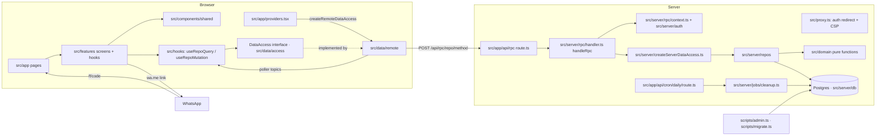
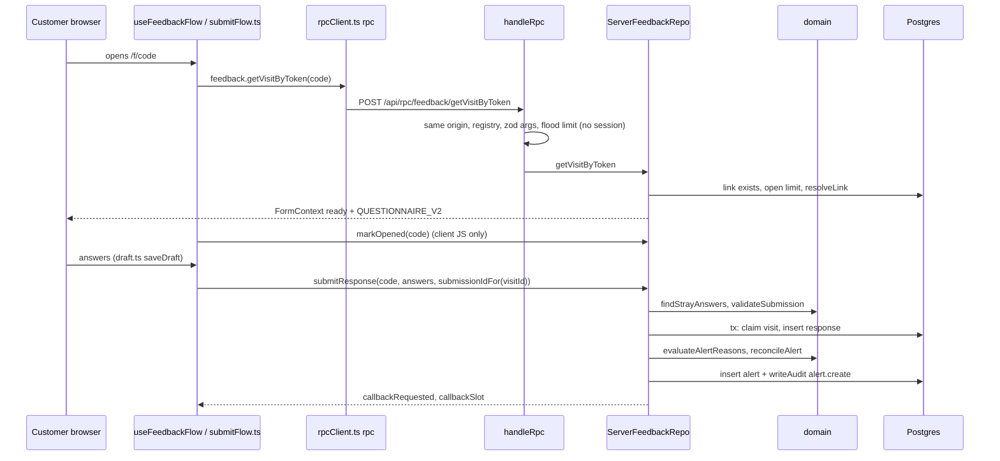
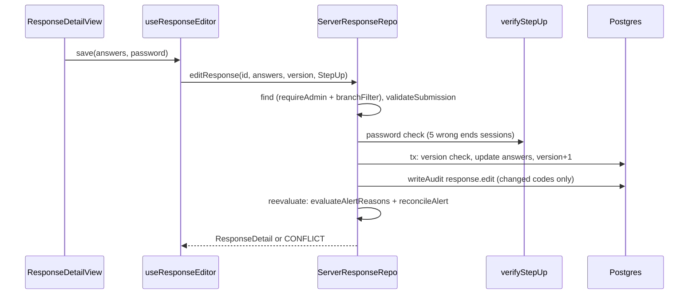
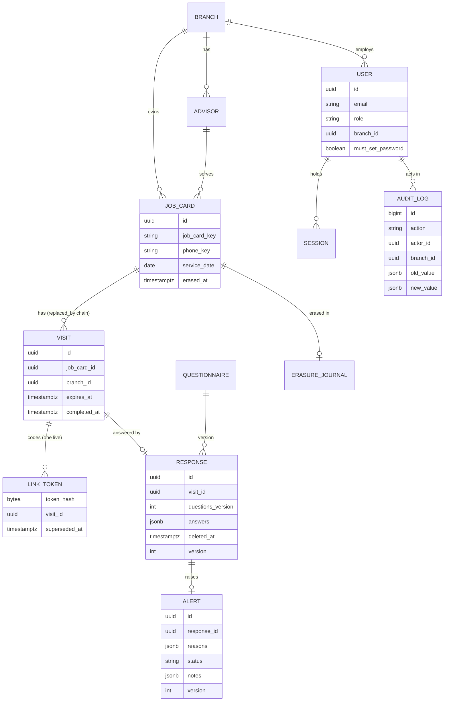

# Architecture (as built) — Chandra Honda PSF, phase 2 (production) with questionnaire v2

> Final, as-built description written at handover, from the code, not from the original plan. Deviations from the plan are listed in §7. Section numbers like "LLD §17.3" point at `docs/LLD-phase2.md` (phase 2, §15–§27) and `docs/LLD.md` (phase 1, §0–§14, still valid where phase 2 amends rather than replaces it); both are synced to the same code.

## 1. What it is
A post-service feedback system for a Honda dealership with several branches. Support staff look up or enter a job card and send the customer a WhatsApp link; the customer answers a short phone form (questionnaire v2: ten questions in six steps, the last one a callback request with a time slot); admins see an overview dashboard, an alert queue for unhappy or callback-requesting customers, editable and deletable responses, an audit log, users, branches, advisors, and (main admin only) customer search, CSV export and erasure. A daily job applies the retention rules.

It is one Next.js 16 app on Vercel with a Postgres database (Neon; PGlite in-process for local dev and tests). Screens still talk only to the `DataAccess` interface (`src/data/access/index.ts`); in phase 2 the browser implementation (`src/data/remote/createRemoteDataAccess.ts`) sends every call to one RPC route, and the server runs a second implementation of the same interfaces (`src/server/createServerDataAccess.ts`) against the database. The phase-1 localStorage demo was deleted (LLD §27).

## 2. System diagram

## 3. Components
| Component | Path | Responsibility | Depends on |
|---|---|---|---|
| Domain | `src/domain/` | Types and zod schemas, `QUESTIONNAIRE_V2` (`src/domain/questionnaire.ts`), show-if engine (`src/domain/visibility.ts`), alert rules (`src/domain/alertRules.ts`), metrics (`src/domain/metrics/`), roles, job-card input, password policy, retention cut-offs, erasure helpers | zod only |
| Data-access contract | `src/data/access/` | `DataAccess` and one interface per repo (`src/data/access/repos/`), `Result`/`ErrorCode` (`src/data/access/result.ts`), `DataAccessProvider` | domain types |
| Remote client | `src/data/remote/` | `createRemoteDataAccess` (a Proxy per repo), `rpc` in `src/data/remote/rpcClient.ts`, activity tracker (`src/data/remote/activity.ts`), poller (`src/data/remote/poller.ts`) | data/access |
| Client composition root | `src/app/providers.tsx` | QueryClient, wires tracker, poller and remote DataAccess; the only importer of `src/data/remote/` | all client layers |
| Data hooks | `src/hooks/` | `useRepoQuery`, `useRepoMutation`, `useLiveInvalidation`, `useSession`, `useOpenAlertCount`, `useFiltersFromUrl`, `useShellActions` | data/access |
| Proxy | `src/proxy.ts` | Redirects signed-out users from staff pages; per-request CSP nonce (`buildCsp`) | `src/config/env.ts` |
| RPC transport | `src/app/api/rpc/[repo]/[method]/route.ts`, `src/server/rpc/` | Same-origin check, registry lookup (`findRpcEntry`), zod args (`src/server/rpc/args.ts`), session, public flood limit, dispatch | server core |
| Server core | `src/server/ctx.ts`, `src/server/scope.ts`, `src/server/audit.ts`, `src/server/rateLimit.ts`, `src/server/tokens.ts`, `src/server/env.ts`, `src/server/log.ts` | `RequestCtx`, `guard`, role and branch scope, `writeAudit`, rate limits, link codes, server env | db, domain |
| Auth | `src/server/auth/` | argon2id passwords, DB sessions and cookies, step-up re-auth (`verifyStepUp`) | db |
| Database | `src/server/db/client.ts`, `src/server/db/schema/`, `drizzle/0000_init.sql` | Drizzle schema (one table per file), `getDb` (Neon pool or PGlite), migrations | Neon / PGlite |
| Server repos | `src/server/repos/` | `Server*Repo` per §2 interface (auth, branches, advisors, users, jobCards, visits, feedback, alerts, analytics, responses, audit, customers) | core, domain |
| Server composition root | `src/server/createServerDataAccess.ts` | Builds every server repo for one request; the only importer of `src/server/repos/` | repos |
| Erasure and CSV | `src/server/erasure.ts`, `src/server/csv.ts` | `eraseJobCards`, `logErasure`, CSV with formula-injection guard | db, domain |
| Daily cron | `src/app/api/cron/daily/route.ts`, `src/server/jobs/cleanup.ts`, `vercel.json` | `runDailyCleanup`: retention erasure, purge of deleted responses, session and limit housekeeping | erasure |
| Maintainer scripts | `scripts/admin.ts`, `scripts/adminClear.ts`, `scripts/migrate.ts`, `scripts/golive-check.ts` | First admin (`initAdmin`), OTP reissue, recover, re-apply erasures, `clearFeedback` (CR-2), migrations, go-live gate | server |
| App shell | `src/app/*/layout.tsx`, `src/components/shared/` | `RoleGuard`, `AdminShell` (`ADMIN_NAV` in `src/components/shared/adminNav.ts`), `SupportShell`, `AccountShell`, dialogs, `SaveState`, `FilterBar` | hooks |
| Features | `src/features/` | `auth`, `account`, `support`, `feedback-form`, `privacy`, `admin-overview`, `admin-alerts`, `admin-responses`, `admin-audit`, `admin-users`, `admin-branches`, `admin-customers` (one folder each) | hooks, shared |

## 4. Key flows (as implemented)

### A. Customer submits feedback (S-12, S-13, F-4, CR-2)

Files involved, in order: `src/app/f/[token]/page.tsx` → `src/features/feedback-form/FeedbackFormScreen.tsx` → `src/features/feedback-form/useFormContext.ts` → `src/data/remote/createRemoteDataAccess.ts` → `src/data/remote/rpcClient.ts` (`rpc`) → `src/app/api/rpc/[repo]/[method]/route.ts` → `src/server/rpc/handler.ts` (`handleRpc`) → `src/server/rpc/context.ts` (`buildBaseCtx`, `withSession`) → `src/server/createServerDataAccess.ts` → `src/server/repos/feedback.ts` (`ServerFeedbackRepo.getVisitByToken`) → `src/features/feedback-form/FeedbackFlowScreen.tsx` → `src/features/feedback-form/useFeedbackFlow.ts` → `src/features/feedback-form/formMachine.ts` / `src/features/feedback-form/draft.ts` → `src/features/feedback-form/submitFlow.ts` (`submitFeedback`) → `src/server/repos/feedback.ts` (`submitResponse`) → `src/domain/visibility.ts`, `src/domain/alertRules.ts` → `src/server/audit.ts` (`writeAudit`) → `src/features/feedback-form/ThankYouView.tsx`.

### B. Admin edits a response (D-07, D-16, LLD §17.5)

Files involved, in order: `src/features/admin-responses/ResponseDetailView.tsx` → `src/features/admin-responses/useResponseEditor.ts` → `src/hooks/useRepoMutation.ts` → (RPC as in flow A) → `src/server/repos/responses.ts` (`editResponse`, `applyEdit`, `reevaluate`) → `src/server/auth/stepUp.ts` (`verifyStepUp`) → `src/server/audit.ts` → `src/domain/alertRules.ts`. The next poll (`src/data/remote/poller.ts`) invalidates queries via `src/hooks/useLiveInvalidation.ts`, so the alert badge (`src/hooks/useOpenAlertCount.ts`) and Overview refresh.

### C. Overview metrics (S-09, S-10, S-11, D-47)
Files involved, in order: `src/app/admin/page.tsx` → `src/features/admin-overview/AdminOverviewScreen.tsx` → `src/features/admin-overview/useOverview.ts` (filters via `src/hooks/useFiltersFromUrl.ts`) → `src/server/repos/analytics.ts` (`ServerAnalyticsRepo.getAnalytics`: loads the period and the previous one in scope, open alerts) → `src/domain/metrics/overview.ts` (`computeOverview`), `src/domain/metrics/categories.ts` (`buildCategories`), `src/domain/metrics/trend.ts` (`buildTrend`), `src/domain/metrics/advisors.ts` (`buildAdvisors`), `src/domain/metrics/advisorScore.ts` (`advisorScore`) → `src/features/admin-overview/KpiTiles.tsx`, `src/features/admin-overview/OverviewBlocks.tsx` (`src/features/admin-overview/TrendChart.tsx`, `src/features/admin-overview/CategoryScores.tsx`, `src/features/admin-overview/QuestionBars.tsx`, `src/features/admin-overview/AdvisorTable.tsx`).

### D. Sessions and live refresh (LLD §18, §20)
Sign-in (`ServerAuthRepo.signIn` in `src/server/repos/auth.ts`) reserves an attempt under an advisory lock, verifies with `verifyPassword`, and `createSession` (`src/server/auth/session.ts`) stores only the SHA-256 of the cookie token. Every RPC reads the session once (`withSession`), touching it on writes or when the browser sends x-psf-active: 1 (`createActivityTracker`). In the browser, `createPoller` emits `STAFF_TOPICS` every poll interval while the tab is visible and in use; `useLiveInvalidation` then invalidates every query. An UNAUTHENTICATED reply makes `rpc` call onUnauthenticated, which refreshes `SESSION_KEY`, and `RoleGuard` sends the user to sign in (`signInUrl` in `src/lib/signInUrl.ts`).

### E. Daily retention (LLD §25)
Vercel Cron calls `src/app/api/cron/daily/route.ts` (bearer secret) → `runDailyCleanup` (`src/server/jobs/cleanup.ts`) → cut-offs from `retentionCutoffs` (`src/domain/retention.ts`) → `eraseJobCards` + `logErasure` (`src/server/erasure.ts`) in batches, purge of deleted responses, session and limit housekeeping, one system.cleanup audit row.

## 5. Data model

One Drizzle file per table in `src/server/db/schema/` (plus sessions, login attempts and rate limits); the whole schema is one migration, `drizzle/0000_init.sql`, including the audit trigger that forbids DELETE, TRUNCATE and UPDATE outside erasure redaction. Answers are one jsonb map per response, validated with the domain schemas (`src/domain/schemas.ts`). Since CR-2 the questionnaires table holds only version 2. Full column list: LLD §16.1.

## 6. Design decisions
| Decision | Chosen | Why | Alternative rejected | Ref |
|---|---|---|---|---|
| Data seam | Keep the phase-1 `DataAccess` interface; swap the implementation | Screens unchanged when the demo became production | Rewrite screens around fetch calls | D-10, LLD §17.1 |
| Transport | One JSON RPC route, one registry table per repo (`src/server/rpc/index.ts`) | Polling never queues behind saves; one door to secure | Server Actions; one REST route per endpoint | LLD §15.1 |
| Database | Neon Postgres + Drizzle; PGlite for dev, unit and e2e tests | Typed SQL, real transactions, no Docker | Prisma; Docker Postgres | LLD §15.1 |
| Region | Vercel functions in sin1 next to Neon Singapore | Sign-in took 3–4.5 s from iad1 | Default region | D-28 |
| Auth | Hand-rolled DB sessions, argon2id (t 8), step-up password for destructive actions | Lockout, one-time passwords and branch scope are custom anyway | Auth.js, Better Auth | D-29, D-30 |
| Roles | support / branch_admin / main_admin, enforced in every repo by `requireAdmin` and `branchFilter` (`src/server/scope.ts`) | Branch data stays in its branch | Client-side checks only | LLD §19 |
| Live refresh | Poll every 30 s while the tab is visible and in use | Simple on Vercel, no sockets | Server push | LLD §20 |
| Links | Random 32-byte codes, only the SHA-256 stored (`src/server/tokens.ts`); per-link open/submit limits | Opaque and revocable | Phase-1 tokens carrying visit details | D-11, LLD §21 |
| Idempotent submit | Client keeps one submission id per visit (`submissionIdFor`); replay returns the same result | Retries on a bad phone network are safe | Server-side dedupe by time | LLD §21 |
| Security headers | Nonce CSP with strict-dynamic in `src/proxy.ts`; all pages dynamic | Owner follow-up on the preview | No CSP | D-31 |
| Questionnaire v2 | Replace v1 outright; `clearFeedback` wipes test feedback; stray answers rejected (`findStrayAnswers`) | No real customer data yet; analytics without version mixing | Map v1 answers to v2 | CR-2, LLD §17.6 |
| Overview v2 | Words-first KPI tiles, category scores /100, weighted advisor score | Owner request | v1 numeric blocks | D-47 |
| Delete | Soft delete, Recently deleted, purge after 30 days | Undo without a backup | Permanent delete | D-04, LLD §25 |
| Alerts after edit | Re-run rules; auto-resolve with a note | Alert never contradicts the answers | Never change | D-07 |
| Erasure | Null personal fields, strip free text, redact audit values, journal ids | Privacy request and retention; restore can re-apply | Delete rows | LLD §24 |
| Layering | dependency-cruiser rules in `.dependency-cruiser.cjs` | Client never imports server code; repos only via the composition root | Convention only | LLD §15.3 |

## 7. Deviations from the original design
| Planned | Built | Why | Ref |
|---|---|---|---|
| `getDb()` returns a Db | Returns a Promise (`getDb` in `src/server/db/client.ts`); PGlite migrates itself on first open | PGlite is a dynamic import | T-15 |
| Only sign-in, current user and feedback are public RPCs | auth.signOut is public too | An ended session must still clear its cookie | T-18 |
| Every public call counts toward the per-IP flood limit | A valid staff session skips it | Staff on one branch connection tripped it | D-32 |
| Sign-in checks then records failures | Reserves the attempt under advisory locks first | Parallel requests could pass the caps | T-20 |
| Only the creator manages a link | Any staff of the link's branch | Owner decision | D-35 |
| Main admin can create job cards | FORBIDDEN (a job card needs a branch) | Owner decision | D-39 |
| Hidden follow-up answers silently dropped | Public submit rejects them with VALIDATION; staff edits still prune (`pruneHidden`) | v1 answers from an old tab must not slip in | CR-2 |
| Form context as a cached query | One-shot effect in `src/features/feedback-form/useFormContext.ts` | Thank-you screen must stay after submit | T-22 |
| `src/config/env.ts` validated with zod | Plain checks | The strict CSP blocks zod's eval probe on client pages | D-34 |
| Planned linkAccess helper file | Folded into `src/server/repos/feedback.ts` | Small; one owner | T-04b |
| Domain JobCard / Visit gain branch fields | Still phase-1 shapes; new fields live on access types, server maps rows (`src/server/repos/analytics.ts`) | Avoid churn in frozen domain files | D-38 |
| listFreshJobCards removed | Still in the registry as an `unavailable` stub (`src/server/repos/unavailable.ts`) | Known minor | T-01b |
| Phase-1 localStorage store, seed and local repos | Deleted; unit tests of screens use `fakeDataAccess` (`tests/support/fakeDataAccess.ts`) | Production phase | LLD §27 |

## 8. Quality gates
`scripts/check.sh` (`pnpm check`) runs, in order: ESLint (complexity, function and file size limits in `eslint.config.mjs`; server-only imports such as the database driver and argon2 are banned outside `src/server` and `scripts`), Prettier check, `tsc --noEmit` (strict), dependency-cruiser layer rules (`.dependency-cruiser.cjs`), a migrations-in-sync check (drizzle-kit must generate nothing new), Vitest with an 80% threshold for lines, functions, branches and statements over `src/domain`, `src/data`, `src/hooks` and `src/server` (`vitest.config.ts`), `next build`, Playwright (projects mobile-360 and desktop-1440 against `next start` on a fresh PGlite prepared by `tests/e2e/global-setup.ts`) and gitleaks. CI runs the same script (`.github/workflows/ci.yml`). Before launch, `scripts/golive-check.ts` (`pnpm golive:check`) must pass.

Known limitations and tech debt:
- The repos still write the audit action advisor.rename while `ACTION_LABELS` (`src/features/admin-audit/auditFormat.ts`) and the domain union only know advisor.update, so rename rows show no label (LLD §23 open item).
- List screens cap at 500 rows (alerts, responses) or 200 (links, customers) without paging; the audit log pages by cursor.
- The response list field still called q12 carries the v2 overall rating Q1 (LLD §17.5).
- Password hashing cost is set but still to be measured on the production region (D-30).
- Free-plan backup is Neon's own short restore window; see `docs/DEPLOY.md` and LLD §26.
- `docs/PRODUCTION.md` is the production-readiness gate checklist: each item is built and tested, waived by the owner, or not applicable.
