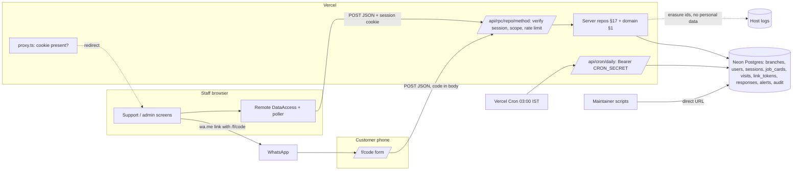

# High-level design — Chandra Honda PSF (phase 2: production)

> CR-1. System view only; module detail is in `docs/LLD-phase2.md` (§15–§27), phase-1 modules in `docs/LLD.md` (§0–§14). Product rules: `docs/SPEC.md`. Diagram source: `.results/lld/dataflow-phase2.mmd`.

## Problem & goal
Turn the browser-only demo into the dealership's production system: one shared server and database, real staff sign-in, several branches whose data is kept apart, job cards typed in by support, customer links that work on any phone, DPDP basics (notice, 3-year retention, access/erasure, backups). Starts empty: question set v1 + one main admin.

## Users & main use cases
| User | Main use cases (SPEC) |
|---|---|
| Customer (anonymous) | Open `/f/<code>`, answer, submit once (US-07–11) |
| Support (one branch) | Sign in, find/enter job card, generate/resend/regenerate/cancel link, watch status (US-01–06, 26) |
| Branch admin (one branch) | Analytics, alerts, responses, audit, advisors, support users of their branch (US-12–21, 25, 27) |
| Main admin (all branches) | All of the above across branches + branches, admin accounts, privacy requests (US-24, 30) |
| Maintainer (not an app role) | Setup, first admin, recovery, migrations, restore (US-23, 32) |
| Vercel Cron (machine) | Daily clean-up (US-31) |

## Scope
- In: SPEC phase 2 (31 production stories), go-live gate §12.1.
- Out: SPEC §11 (email/SMS, DMS, WhatsApp API, custom domain at launch, bulk export, 2FA).

## Success metrics
SPEC §12 Definition of done; customer form < 2 s on 4G; staff lists < 1 s; Overview < 2 s; US$ 0 until the gate, ≈ US$ 20–45/month after.

## Parts
| Part | Runs on | Responsibility | Talks to |
|---|---|---|---|
| Next.js app — pages | Vercel (static + client JS) | Same phase-1 screens (client components) over the `DataAccess` interface | RPC route |
| Next.js app — `src/proxy.ts` | Vercel (Node) | Optimistic check only: no session cookie on a staff path → redirect `/sign-in?next=`; never touches the DB | — |
| Next.js app — RPC route `/api/rpc/[repo]/[method]` | Vercel Functions (Node) | The only data door: origin check, input zod, session verify + touch, role + branch scope, rate limits, then the server repo | Neon |
| Next.js app — cron route `/api/cron/daily` | Vercel Functions, called by Vercel Cron 1×/day | Retention erasure, purge deleted, expire sessions/attempts; bearer `CRON_SECRET` | Neon |
| Neon Postgres | Neon (region nearest India, e.g. Singapore) | All data; schema only by versioned migrations; point-in-time restore (6 h free, 7 days paid) | — |
| Maintainer scripts `scripts/admin.ts`, `scripts/migrate.ts` | Maintainer laptop / Vercel build | Setup on empty DB, one-time password re-issue, recovery; migrations | Neon (direct URL) |
| WhatsApp | Customer's/staff phone | `wa.me` deep link only; no account | — |

## Data flow

## Trust boundaries
| Boundary | Who crosses | Allowed | Controls |
|---|---|---|---|
| Internet → public | anyone with a link | `feedback.getVisitByToken/markOpened/submitResponse`, `auth.signIn`, `auth.currentUser`, `/privacy` | Code = 32 random bytes, only its SHA-256 stored; returns only that visit's name, model, reg. no, date; per-link limits 30 opens + 5 submits/h, 300 req/h per IP; `Referrer-Policy: no-referrer` |
| Internet → staff | signed-in staff | every other RPC | httpOnly Secure SameSite=Lax session cookie; token hashed in DB; idle 2 h / 12 h, 7 d max; JSON-only POST + Origin check (CSRF); role + branch scope on every call; out of scope → `NOT_FOUND`/`FORBIDDEN`, no partial data |
| Staff → sensitive action | admins | edit/delete/restore response, erase customer | Step-up password on the server; 5 wrong/15 min → signed out; audit |
| Vercel Cron → cron route | scheduler | clean-up only | `Authorization: Bearer CRON_SECRET`, constant-time compare; idempotent, batched |
| Maintainer → DB | maintainer | setup, re-issue, recovery, migrations, restore | Direct URL held only by maintainer; `init` refuses when users exist; every action audited as `system` |
| App → providers | Vercel, Neon | store and process data | Secrets only in Vercel env; data may be outside India (stated in the notice) |

## Branch scoping model
Every staff request gets a `Scope` from the session user, never from the client: `support`/`branch_admin` → `{ branch: user.branchId }`; `main_admin` → `{ all }`, optionally narrowed by a `branchId` filter. Every server query on branch-owned rows (`job_cards`, `visits`, `responses` via visit, `alerts`, `advisors`, `users`, `audit_log`) adds the scope predicate through one helper (LLD §19). A row outside scope is indistinguishable from a missing row (`NOT_FOUND`). Links belong to the branch (G-8): any support user of the branch acts on any of its links.

## Auth & session model
Hand-rolled DB sessions (LLD §18): sign-in checks an argon2id hash → random 32-byte token in the cookie, SHA-256 of it in `sessions`. Each RPC re-reads the session (no trust in the proxy or layouts). The idle clock moves only on user activity (writes, or reads the client flags as user-driven), not on background polling, so an unattended desk signs out on time. Sessions are deleted on sign-out, deactivation, password reset, role/branch change and own password change (other sessions). Lockout: 5 failed sign-ins per email per 15 min, cleared by an admin reset; 30 per IP per 15 min. Temporary and one-time passwords force "Set your password".

## Live refresh
Polling, not push: every 30 s (`NEXT_PUBLIC_POLL_SECONDS`) only while the tab is visible and used in the last 15 min; once on return. No polling on public pages. Lets Neon sleep at night (G-6).

## Free now, paid later (no code change)
| Item | Free (build + test, staff test data only) | Paid (go-live gate) | Change needed |
|---|---|---|---|
| Hosting | Vercel Hobby (non-commercial only) | Vercel Pro | Plan in dashboard |
| Database | Neon Free: 1 GB, 100 CU-h/month, 6 h restore, autosuspend | Neon Launch: 7-day restore window | Plan + history-retention setting in Neon console; same connection string |
| Cron | Daily, ±1 h | Same entry, precise | None |
| Function logs | short retention (~1 h, unverified) | ~1 day (unverified) | None: erasure re-apply uses the DB journal, LLD §26 |
| Backups | Neon 6 h restore only; no real data allowed | Neon point-in-time restore 7 days; rehearsal | None (LLD §26) |
| Poll cadence | 30 s | 30 s or lower | Env var only |

## Go-live gate (SPEC §12.1) — technical checks
1. Vercel Pro + Neon paid; Neon history retention = 7 days; a partial restore rehearsed (DEPLOY.md).
2. Env: `APP_URL` = production address; `NEXT_PUBLIC_COMPANY_NAME`, `NEXT_PUBLIC_PRIVACY_PHONE`, `NEXT_PUBLIC_PRIVACY_EMAIL`, `NEXT_PUBLIC_DEALER_PHONE` hold real values (`pnpm golive:check` fails on placeholders).
3. First main admin created and has set their password.
4. Demo Vercel project taken offline (LLD §27).
5. Privacy notice legally checked (owner, outside the app).

## Milestones
| # | Milestone | Outcome |
|---|---|---|
| M3 | Empty system you can sign into | Schema + migration, server data access + RPC, auth/sessions/lockout, branches, advisors, users, setup script, proxy; deployed on free plans |
| M4 | Support → customer loop across devices | Job card entry, hashed links with resend, public form on any phone, alerts, polling |
| M5 | Admin console, privacy, clean-up, go-live readiness | Scoped analytics/alerts/responses/audit, customer search/export/erase, daily cron, DEPLOY.md, demo code removed, gate checks |

## Risks & assumptions
- Vercel Hobby forbids commercial use: real customers only on Pro (already the gate).
- Neon Free 100 CU-h: polling during ~12 staff hours/day fits only just; the idle-tab rule is mandatory.
- Hobby function-invocation allowance vs polling (unverified): fine for test traffic; real traffic runs on Pro.
- `@node-rs/argon2` on Vercel not verified first-hand: preview smoke test in M3; fallback `@noble/hashes` argon2id.
- Raw link codes appear in Vercel request logs (URL path), kept briefly; accepted (only hashes in the DB).
- Analytics computed in TypeScript over the filtered period's rows; a 3-year all-branches range may exceed 2 s (move aggregation to SQL if measured).
- Drizzle 0.45 → v1 later changes the migration folder format (one planned upgrade).
