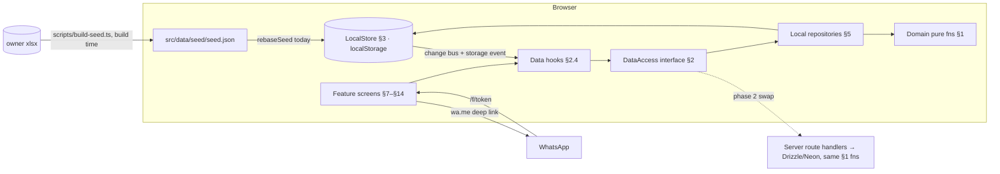
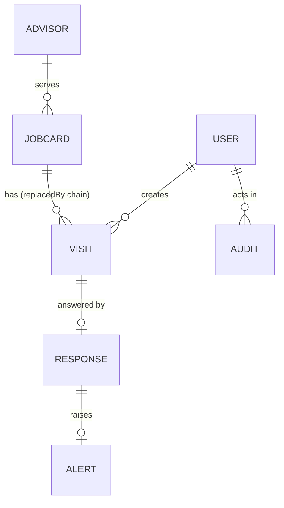

# Low-level design — Chandra Honda PSF (phase 1 as built · phase 2 in `docs/LLD-phase2.md` §15–§27)

> **Phase 2 (CR-1):** production design continues in `docs/LLD-phase2.md` (§15–§27; system view `docs/HLD.md`). It supersedes §2.5 and removes §3–§5 and the demo parts of §6–§7; §17.2 lists the amendments to §1, §2, §6–§14.
> Numbered, self-contained sections: brief a task with only the sections it needs (e.g. `LLD §2, §8`).
> **Numbers are stable** — update in place, new sections get new numbers, removed ones are marked `(removed)`. Size cap: medium, 400 lines.
> Product rules (questions, triggers, metric formulas, copy) live in `docs/SPEC.md`; this file says where and how they are built. As-built at the M2 handover. Diagram source: `.results/lld/dataflow.mmd`.

## §0 Overview

### §0.0 Big picture
| Module | Responsibility | Talks to | Stories |
|---|---|---|---|
| §1 Domain | Pure types, questionnaire config + `show_if` engine, alert rules, metrics, phone/job-card/WhatsApp helpers. Reused server-side in phase 2 | nothing (zod only) | US-02, 04, 08, 09, 12, 14–16 |
| §2 Data-access contract | Repository interfaces, `Result` type, provider, data hooks (TanStack Query) + live invalidation | §1 types | all |
| §3 Local store | localStorage collections, cross-tab lock + change bus, simulated failed save | §2 (implements its subscribe) | S-06, S-13, US-11 |
| §4 Seed pipeline | Build-time xlsx → committed JSON fixture; runtime rebase of dates to "today" | §1, §3 | US-22, S-07 |
| §5 Local repositories | Phase 1 implementation of every §2 interface, role checks inside | §1, §3, §4 | all |
| §6 App shell & shared UI | Root providers (composition root), role guards, admin/support nav, shared components | §2 | US-01 |
| §7 Auth | Sign-in, set-password, reset dialog + `AuthRepo`, `DemoRepo` | §2, §6 | US-01, 20 (S-15), 22 |
| §8 Support | Link list, lookup, generate/send/regenerate/cancel | §2, §6 | US-02–06 |
| §9 Feedback form | `/f/[token]` welcome → steps → callback → thank-you, link states, draft | §2, §1 | US-07–12 |
| §10 Overview | Filter bar + KPI tiles + 7 analytics blocks | §2, §6 | US-14–16 |
| §11 Alerts | Queue, drawer, status/notes, nav badge count | §2, §6 | US-12, 13 |
| §12 Responses | List, detail, edit/delete/restore with step-up password, recently deleted | §2, §6, §1 | US-17, 18, 21 |
| §13 Audit | Append-only audit list | §2, §6 | US-19 |
| §14 Users | Add / deactivate / reactivate support users | §2, §6 | US-20 |



**Milestones** (both closed): **M1** support → customer loop on a phone (foundation, seed, sign-in, support, form + alerts, Vercel at 360 px); **M2** admin console (overview metrics, alerts, responses edit/delete/restore, audit, users, reset, simulated failed save; SPEC §5 examples, Definition of Done).

### §0.1 Stack
| Layer | Choice | Why | Rejected alternative |
|---|---|---|---|
| App | Next.js App Router, TypeScript strict, one app at repo root | Owner constraint; Vercel native | Vite SPA (no phase-2 server routes) |
| UI | Tailwind v4 + shadcn/ui (copied into `src/components/ui`) + lucide | Owner constraint; owned source, dark-mode tokens | MUI |
| Charts | Recharts | Owner constraint | Chart.js |
| Validation | Zod (seed, store collections, form submission, env) | Shared client/server in phase 2 | Valibot |
| Data hooks | TanStack Query v5 over §2 | Saving/error states, invalidation; unchanged against a remote API | Hand-written `useSyncExternalStore` hooks |
| Storage | localStorage, one key per collection, Web Locks for cross-tab writes | ~1 MB data, sync read-modify-write in a lock, `storage` event = free cross-tab sync | IndexedDB/Dexie (async, extra dep) |
| Seed | Build-time script → committed JSON fixture | No xlsx parser in the browser; reviewable diffs | Runtime xlsx parsing (≈400 KB) |
| Tests | Vitest (unit, jsdom) + Playwright (e2e per S-xx) | Fast unit loop; real browser for tabs, storage, 360 px | Jest; Cypress |
| Dates | `Intl.DateTimeFormat` with `Asia/Kolkata` | No dependency | date-fns-tz |

### §0.2 Folder structure
```
src/
  app/                         routes only; each page.tsx renders one feature screen
    layout.tsx providers.tsx robots.ts page.tsx(→/sign-in) not-allowed/ not-found.tsx error.tsx
    sign-in/ set-password/ (§7)   support/ page.tsx new/ (§8)   f/[token]/ (§9)
    admin/ layout.tsx page.tsx alerts/ responses/ responses/[id]/ responses/deleted/ audit/ users/   §10–§14
  features/<auth|support|feedback-form|admin-overview|admin-alerts|admin-responses|admin-audit|admin-users>/
                               one flat folder per feature: screens, components, hooks
  components/ui/ (shadcn)  components/shared/ (§6)  hooks/ (§2.4)
  data/access/                 §2 interfaces (repos/<name>.ts), Result, provider
  data/local/                  §3 store, db, bus, fault, crypto, seed; §5 repos/, repoDeps, session, results, ids, createLocalDataAccess.ts
  data/seed/seed.json          §4 generated fixture (committed)
  domain/ (§1, metrics/ = §1.4)    config/env.ts (§0.5)
scripts/build-seed.ts  scripts/seed/{data,entities,answers}.ts  scripts/check.sh
tests/support/  tests/unit/<area>/  tests/e2e/<feature>/      docs/DEPLOY.md (Vercel runbook)
```

### §0.3 Layer map and module dependencies
`app → features → components/shared, hooks → data/access → domain`; `data/local → data/access, domain`. Composition root: `src/app/providers.tsx` is the **only** importer of `@/data/local`.
dependency-cruiser (`.dependency-cruiser.cjs`) rules, all `severity: error`:
| Rule | From | Forbidden to |
|---|---|---|
| domain-pure | `^src/domain` | anything in `src/` outside `src/domain`; any npm package except `zod` |
| access-pure | `^src/data/access` | `src/data/local`, `src/features`, `src/components`, `src/app` |
| local-hidden | `^src/(features\|components\|hooks)` and `^src/app/(?!providers)` | `src/data/local` |
| no-cross-feature | `^src/features/([^/]+)/` | `^src/features/(?!$1)` |
| shared-no-features | `^src/(components\|hooks)` | `src/features`, `src/app` |
| no-circular | any | circular |
ESLint `no-restricted-globals` (`localStorage`, `sessionStorage`) everywhere except `src/data/local/**` and `src/features/feedback-form/draft.ts`. Complexity ≤ 10, function ≤ 40 lines, file ≤ 300 (`eslint.config.mjs`).

### §0.4 Packages
Pinned by env-setup (D-13; pnpm, node ≥ 24, lockfile committed); full table with rejected alternatives: `.results/lld/packages.md`. Runtime: next 16, react 19, tailwindcss 4 (+ tw-animate-css), shadcn/radix-ui, lucide-react, sonner 2, recharts 3, zod 4, @tanstack/react-query 5. Dev: typescript 5.9, eslint 9 + typescript-eslint 8 + eslint-config-next 16, prettier 3, dependency-cruiser 17, vitest 4 (+ coverage-v8, jsdom, testing-library/react 16), @playwright/test 1.x, exceljs 4, tsx 4, gitleaks 8 (binary).

### §0.5 Config and secrets
`src/config/env.ts` is the only reader of `process.env` (literal accesses so Next inlines them) and parses with zod into `env`; keys in `.env.example`. No secrets exist in phase 1 (all client code). Values are inlined at build time: changing one needs a redeploy. **Non-production fallback:** when `NODE_ENV !== "production"` (dev, unit tests) missing keys fall back to the public sample values from `.env.example`, so `pnpm dev` works with no `.env`; production builds still fail on a missing required key.
| Key | Required | Example | Use |
|---|---|---|---|
| `NEXT_PUBLIC_DEMO_PASSWORD` | yes (`min(1)`) | `Demo@2026` | Password of seeded users. **Intentionally public**: sign-in hint, plain (non-secret) Vercel variable |
| `NEXT_PUBLIC_APP_URL` | optional | `https://chandra-psf.vercel.app` | Base of `/f/<token>` links; unset/empty → `window.location.origin` (previews work); trailing `/` stripped (§8 `linkBase`). Not set in Vercel |
| `NEXT_PUBLIC_DEALER_PHONE` | yes (`min(1)`) | `+91 44 0000 0000` | Contact line on link-state pages (placeholder until the owner sets the real number) |
Site: `src/app/robots.ts` disallows all; root metadata `robots: "noindex"`; unknown routes → `not-found.tsx`, runtime errors → `error.tsx` (no stack shown). **Deployment:** Vercel project `chandra-psf` (https://chandra-psf.vercel.app), framework auto-detected, **no `vercel.json`**; env vars for Production and Preview. Runbook: `docs/DEPLOY.md`.
## §1 Domain (pure)
- **Path:** `src/domain/` · **Depends on:** zod only. Every function deterministic; time comes in as a `now: Date` argument.
- **Ownership (one task per file):** T-01 foundation, frozen: `types, schemas, questionnaire, answers, time, visitStatus, constants, visibility, alertRules`; T-03 (§8): `jobCard, phone, whatsapp`; T-06 (§10): `metrics/**` (`overview, scores, stats, trend, breakdowns, comments, filters`).
- `constants.ts`: `LINK_EXPIRY_DAYS = 7`, `TEXT_MAX_LENGTH = 1000`, `DEFAULT_RANGE_DAYS = 30`, `RECENT_COMMENTS = 10`, `MIN_PASSWORD_LENGTH = 8`, `AUTO_RESOLVE_NOTE`, `SYSTEM_ACTOR = "system"` (CONVENTIONS §5).

### §1.1 Types (`types.ts`) and schemas (`schemas.ts`, zod mirrors)
```ts
type Role = 'admin' | 'support';
type ISODate = string /* YYYY-MM-DD, IST */; type ISOTime = string /* UTC ISO */;
interface User { id: string; name: string; email: string; role: Role; active: boolean; mustSetPassword: boolean; createdAt: ISOTime }
interface Advisor { id: string; name: string }
interface JobCard { jobCardNo: string; customerName: string; phone: string | null; regNo: string; model: string;
  vehicleType: 'scooter' | 'motorcycle'; serviceType: string; serviceDate: ISODate; advisorId: string }
interface Visit { id: string; jobCardNo: string; phone: string | null; token: string; createdBy: string; createdAt: ISOTime;
  expiresAt: ISOTime; openedAt: ISOTime | null; completedAt: ISOTime | null; cancelledAt: ISOTime | null; replacedBy: string | null }
type VisitStatus = 'created' | 'opened' | 'completed' | 'expired' | 'cancelled';
type QuestionCode = `Q${number}` | `Q${number}a`;
type AnswerValue = number | string | { options: string[]; text?: string };
type AnswerMap = Partial<Record<QuestionCode, AnswerValue>>;
interface ResponseRecord { id: string; visitId: string; questionsVersion: number; submittedAt: ISOTime; answers: AnswerMap; deletedAt: ISOTime | null }
type AlertReason = { kind: 'callback' } | { kind: 'low_rating'; code: 'Q1' | 'Q6' | 'Q11' | 'Q12' };
type AlertStatus = 'open' | 'contacted' | 'resolved';
interface Alert { id: string; responseId: string; reasons: AlertReason[]; status: AlertStatus; notes: { at: ISOTime; by: string; text: string }[]; createdAt: ISOTime; updatedAt: ISOTime }
type AuditAction = 'link.create' | 'link.regenerate' | 'link.cancel' | 'response.edit' | 'response.delete' | 'response.restore'
  | 'alert.create' | 'alert.status' | 'alert.note' | 'user.create' | 'user.deactivate' | 'user.reactivate' | 'user.set_password';
interface AuditEntry { id: string; at: ISOTime; actorId: string; actorName: string; action: AuditAction; entityType: 'visit' | 'response' | 'alert' | 'user';
  entityId: string; oldValue: unknown; newValue: unknown; note?: string }
interface Filters { from: ISODate; to: ISODate; vehicleType?: JobCard['vehicleType']; model?: string; advisorId?: string }
```
Answer rows for phase 2 (`value_num/value_text/value_options`): `toAnswerRows(map)` / `fromAnswerRows(rows)` in `answers.ts`.

### §1.2 Questionnaire config (`questionnaire.ts`) — variation point: data, not code
```ts
type QuestionType = 'rating_5' | 'yes_no' | 'yes_partial_no' | 'text' | 'single_select' | 'multi_select_text';
type ShowIf = { op: 'lte' | 'gte'; value: number } | { op: 'eq'; value: number | string } | { op: 'in'; value: string[] };
interface Question { code: QuestionCode; step: 1|2|3|4|5|6; text: string; type: QuestionType; required: boolean;
  parent?: QuestionCode; showIf?: ShowIf; options?: string[]; maxLength?: number /* 1000 for text */; textRequired?: boolean }
interface Questionnaire { version: number; steps: { n: number; title: string }[]; questions: Question[] }
export const QUESTIONNAIRE_V1: Questionnaire   // content = SPEC F-3 tables verbatim
```
`visibility.ts`: `isVisible(q, answers)`, `visibleQuestions(step, answers)`, `isStepComplete(step, answers)`, `pruneHidden(answers): AnswerMap`, `validateSubmission(answers): { ok: true; answers } | { ok: false; missing: QuestionCode[] }` (prunes first, then checks required + `textRequired` + `maxLength`).

### §1.3 Alert rules (`alertRules.ts`)
`evaluateAlertReasons(answers): AlertReason[]` (SPEC F-4 step 1; callback first, then Q1, Q6, Q11, Q12) · `formatReasons(r): string` → `"Callback requested · Q12 rated 1"` · `reconcileAlert(existing: Alert | null, reasons, now, ids?: { id; responseId }): { alert: Alert | null; change: AlertChange }` with `AlertChange = 'none' | 'created' | 'reasons_updated' | 'auto_resolved'` (SPEC F-4 step 4; note `AUTO_RESOLVE_NOTE` = `"Auto-resolved: no alert reason after edit"`). `ids` names a new alert (caller generates the id, keeping §1 id-free).

### §1.4 Metrics (`metrics/`)
`scores.ts`: `ratingScore`, `yesNoScore(code, v)`, `stepScores`, `mean`, `categoryScore(step, answers)` (SPEC F-5; Q3 reversed, Q2 partial = 50). `stats.ts`: `round1`, `avgRating`, `yesPercent`, `delta`. `trend.ts` `buildTrend`, `breakdowns.ts` `buildProblems`/`buildQuestionDetail`, `comments.ts` `buildComments`.
`overview.ts`: `computeOverview(input: AnalyticsInput, f: Filters, advisorNames: Record<string, string> = {}): OverviewData` (names map ids → display; unknown id falls back to the id) where
```ts
interface AnalyticsInput { visits: { visit: Visit; jobCard: JobCard }[]; responses: { response: ResponseRecord; visit: Visit; jobCard: JobCard }[]; openAlerts: number; now: Date }
type Metric = { value: number | null; previous: number | null; delta: number | null };   // null → "—", arrow hidden
interface OverviewData { kpis: { responses: Metric; responseRate: Metric; avgQ12: Metric; recommendRate: Metric; openAlerts: number };
  categoryScores: { step: number; title: string; score: number | null }[];
  trend: { granularity: 'week' | 'month'; points: { bucketStart: ISODate; avgQ12: number | null; recommendRate: number | null }[] };
  advisors: { advisorId: string; name: string; responses: number; avgQ6: number | null; q4Yes: number | null; q7Yes: number | null; avgQ12: number | null }[];
  problems: Record<'Q1a'|'Q3a'|'Q6a'|'Q7a'|'Q9a'|'Q11a', { option: string; count: number }[]>;
  questionDetail: { code: QuestionCode; split: { answer: string; count: number }[] }[];
  comments: { responseId: string; serviceDate: ISODate; source: QuestionCode; text: string; q12: number }[] }
```
Rules: filter by **service date**; `responses` input already excludes deleted; **response rate (D-17)** = visits with `completedAt` **and a live (non-deleted) response** ÷ eligible visits in scope (excludes cancelled and replaced visits, `replacedBy != null`); so deleting a response lowers the rate and restoring raises it back; no eligible visits → `null`; previous period = same length immediately before `from`; comments newest 10.
`filters.ts`: `defaultFilters(now)` (last 30 days), `previousPeriod(f)`, `matches(jobCard, f)`.

### §1.5 Helpers
| File | Function | Rule |
|---|---|---|
| `jobCard.ts` | `normalizeJobCardNo(s): string` | upper-case, strip spaces/dashes → compare on `JC241042` (S-02) |
| `phone.ts` | `toWhatsAppNumber(phone): string \| null` | digits only; 10 digits starting 6–9 → `91…`; `91`+10 → as is; else `null` (landline/blank, S-03) |
| `whatsapp.ts` | `buildWhatsAppUrl(phone, ctx: WhatsAppContext { name; model; regNo; url }): string \| null` | SPEC §5 template, `encodeURIComponent`; `null` when no mobile |
| `visitStatus.ts` | `visitStatus(v, now): VisitStatus` | cancelled › completed › expired (`replacedBy` or `now > expiresAt`) › opened › created |
| `time.ts` | `formatIST(t)`, `formatISTDate(d, { year? })`, `istDateOf(t \| Date)`, `addDays`, `daysBetween`, `istToISOTime(date, minute)` | display only IST; `istToISOTime` used by seed rebase |

## §2 Data-access contract
- **Path:** `src/data/access/`, `src/hooks/` · **Depends on:** §1 types. **Frozen after the foundation** (two post-freeze fixes in `hooks/`, see Changes).

### §2.1 Result and errors (`result.ts`)
```ts
type ErrorCode = 'UNAUTHENTICATED' | 'FORBIDDEN' | 'NOT_FOUND' | 'VALIDATION' | 'CONFLICT' | 'ALREADY_COMPLETED'
  | 'BAD_CREDENTIALS' | 'ACCOUNT_DISABLED' | 'BAD_PASSWORD' | 'EMAIL_IN_USE' | 'SAVE_FAILED' | 'UNAVAILABLE';
type RepoError = { code: ErrorCode; message: string; fields?: string[] };
type Result<T> = { ok: true; value: T } | { ok: false; error: RepoError };
const ok, err;   type StepUp = { password: string };   type Topic = 'session'|'visits'|'responses'|'alerts'|'audit'|'users';
```
Every method is `async` and **never throws**; an unexpected exception becomes `SAVE_FAILED` (writes) or `UNAVAILABLE` (reads). Role checks happen **inside** the implementation: staff methods return `UNAUTHENTICATED` / `FORBIDDEN`. Step-up methods take `StepUp` and return `BAD_PASSWORD`.

### §2.2 `DataAccess` (`index.ts`)
```ts
interface DataAccess { auth: AuthRepo /*§7*/; demo: DemoRepo /*§7*/; jobCards: JobCardRepo /*§8*/; visits: VisitRepo /*§8*/;
  feedback: FeedbackRepo /*§9*/; analytics: AnalyticsRepo /*§10*/; alerts: AlertRepo /*§11*/; responses: ResponseRepo /*§12*/;
  audit: AuditRepo /*§13*/; users: UserRepo /*§14*/; subscribe(listener: (topics: Topic[]) => void): () => void }
```
Repo interfaces live in `src/data/access/repos/<name>.ts` with the signatures in their feature sections; feature tasks may not change them (Tier 1).

### §2.3 Provider (`provider.tsx`)
`<DataAccessProvider value={da}>`, `useDataAccess(): DataAccess`. Renders children only after mount (storage is client-only); full-page skeleton before.

### §2.4 Data hooks (`src/hooks/`)
| Hook | Signature | Notes |
|---|---|---|
| `useRepoQuery` | `<T>(key: RepoQueryKey /* [Topic \| 'analytics', ...unknown[]] */, fn: (da) => Promise<Result<T>>) → { data?; error?; isLoading }` | wraps `useQuery`; error results are surfaced, not thrown |
| `useRepoMutation` | `<I, T>(fn: (da, input: I) => Promise<Result<T>>) → { run(i): Promise<Result<T>>; status: 'idle'\|'saving'\|'error'\|'done'; error?; reset() }` | drives every saving state and "Couldn't save, try again" (S-13) |
| `useLiveInvalidation` | `() → void` | mounted once in providers; `da.subscribe` → `invalidateQueries()` (all). Phase 2: polling/SSE-backed `subscribe` |
| `useSession` / `SESSION_KEY` | `() → { user: User \| null; isLoading }`; `SESSION_KEY = ['session'] as const` | `SESSION_KEY` is the one query key, also used by `useSignIn` / `useSetPassword` to invalidate (`refetchType: "all"`) |
| `useOpenAlertCount` | `() → number` | key `['alerts','openCount']`, admin nav badge |
| `useShellActions` | `() → { signOut(); simulateFailedSave() }` | both shells; sign out → `/sign-in`; arm fault → toast "The next save will fail" |
| `useFiltersFromUrl` | `() → { filters: Filters; setFilters(f) }` + exported `dateOf(raw): string \| null` | filters live in the URL query (needs `<Suspense>`); `dateOf` accepts only `YYYY-MM-DD` that **round-trips** as a real calendar date (rejects `2026-13-45`, `2026-02-30`); bad `from`/`to` fall back to the default range |
Feature-specific hooks live in their feature folder and are built on these.

### §2.5 Phase 2 swap — superseded by LLD-phase2 §17 (RPC route + server repos + `createRemoteDataAccess`)

## §3 Local store
- **Path:** `src/data/local/store.ts`, `db.ts`, `bus.ts`, `fault.ts`, `crypto.ts` · **Depends on:** §1 schemas (`DbSchemas`, `SessionSchema`), §2 `Topic`. **Frozen after the foundation.**

### §3.1 Interfaces
```ts
// db.ts: Clock { now(): Date }; StoredUser = User & { passwordHash }; Db { meta: { schemaVersion: 1; seededAt }; users: StoredUser[];
//   advisors; jobCards; visits; responses; alerts; audit }
// store.ts: KEY_PREFIX = 'psf:v1:'; class SaveFailed extends Error (default "Couldn't save, try again")
interface StoreDeps { storage; locks: LockManager | null; bus: ChangeBus; fault: FaultSwitch; clock: Clock;
  seeder: (now: Date) => Promise<Db> /* injected §4 rebase */; win?: Pick<Window, 'addEventListener' | 'removeEventListener'> }
class LocalStore { constructor(deps: StoreDeps); readonly fault: FaultSwitch
  read<K extends keyof Db>(k: K): Db[K]       // sync parse + zod; missing key → [] (meta → throws "not seeded"). Never seeds
  readSession(): { userId } | null; writeSession(userId | null): void   // emits 'session'; bad JSON → null
  whenReady(): Promise<void>                  // = ensureSeeded(clock.now()); every repo awaits it before reading
  ensureSeeded(now): Promise<void>            // memoised, under the lock; seeds only when `meta` is absent
  wipeAndReseed(now): Promise<void>           // removes every `psf:` key (session, drafts too), re-seeds, emits all
  mutate<K extends keyof Db, T>(keys: K[], fn: (draft: Pick<Db, K>) => T): Promise<T> }
class ChangeBus { emit(topics: Topic[]): void; on(l: TopicListener): () => void }
class FaultSwitch { constructor(session: SessionStore); armNextWrite(); consume(): boolean; armFromSearch(search) }
  // sessionStorage `psf:fault`, armed by `?demoFail=1`; throws SaveFailed("Simulated failed save")
hashPassword(pw: string): Promise<string>   // SHA-256 via crypto.subtle, demo only
```
Seed writes `meta` last (a failed seed never looks seeded). Key → topics: `users → users, session`; `jobCards/advisors/visits → visits`; `responses → responses, visits`; `alerts → alerts, responses`; `audit → audit`; `meta` / cleared storage → all. Keys: `psf:v1:<collection>`, `psf:v1:session` (`{ userId }`), drafts `psf:draft:<visitId>` (§9).

### §3.2 Write sequence (no overwrites, S-06)
`mutate` → `whenReady()` → `navigator.locks.request('psf-db', …)` (direct call if unsupported) → if `fault.consume()` throw `SaveFailed` → **re-read** the listed keys fresh → run `fn` → zod-validate and write only keys whose JSON changed → `bus.emit(topics)` (nothing changed → no emit). Other tabs: `window 'storage'` event on `psf:v1:*` → `bus.emit(topicsOfKey(key))` → §2.4 invalidates. Any `setItem` failure (incl. `QuotaExceededError`) → keys already written in this call are restored → `SaveFailed`.

### §3.3 Schema owned


## §4 Seed pipeline
- **Path:** `scripts/build-seed.ts` (`pnpm seed`; helpers `scripts/seed/data.ts`, `entities.ts`, `answers.ts`), output `src/data/seed/seed.json`, runtime `src/data/local/seed.ts` · **Depends on:** §1 (schemas, `evaluateAlertReasons`).
- **Build time:** reads the xlsx with exceljs; applies SPEC §6 seed rules (Q11 `ceil(x/2)`, follow-ups from Q14 hints, Q15 = Yes on CUST-006/014/022, 2–3 extra rating-1 responses, 4 advisors, 5 models, ~10 unanswered visits incl. expired, ~10 job cards with no visit, 1 admin + 2 support users without passwords); deterministic (fixed PRNG seed); validated with `SeedSchema` (`build-seed.ts --check` in `scripts/check.sh`). Job card `JC-24-1042` = SPEC §5 Ramesh Kumar row, **no** visit.
- **Fixture shape:** same as `Db` but every timestamp is `{ dayOffset: number; minute: number }` (≤ 0, relative to load day); alerts carry seeded status/notes.
- **Runtime:** `rebaseSeed(seed, now, password): Promise<Db>` → absolute dates counted back from `now`'s IST day; users get `hashPassword(env.NEXT_PUBLIC_DEMO_PASSWORD)`. Injected into `LocalStore` as `seeder` by `createLocalDataAccess`; run by `ensureSeeded` and `wipeAndReseed`.

## §5 Local repositories
- **Path:** `src/data/local/repos/<name>.ts`, composition root `src/data/local/createLocalDataAccess.ts` (`(deps: LocalDataAccessDeps { storage; locks; clock; win: Window }) => DataAccess`; builds `ChangeBus`, `FaultSwitch(win.sessionStorage)` + `armFromSearch(location.search)`, `LocalStore` with the §4 seeder, starts `whenReady()`). **Depends on:** §1, §2, §3.
- Each repo is a class `Local<Name>Repo` taking `RepoDeps { store: LocalStore; clock: Clock; session: SessionReader }` (`repoDeps.ts`). `session.ts`: `SessionReader.current(): User | null` (`StoreSessionReader`: `store.readSession()` + `users`; deactivated or unreadable → null), `toPublicUser(StoredUser): User` strips the hash.
- Frozen helpers: `results.ts` — `guardRead(fn)` / `guardWrite(fn)` turn a thrown error into `UNAVAILABLE` / `SAVE_FAILED`, `notBuilt()`, `SAVE_FAILED_MESSAGE`; `ids.ts` — `newId(prefix)`. Reads: `await store.whenReady()` then `store.read`; writes: `store.mutate`. T-01 created every repo file as a stub; each file below then had one owning task.
| File | Exports | Owner task (§) | Milestone |
|---|---|---|---|
| `auth.ts`, `demo.ts` | AuthRepo, DemoRepo | T-02 (§7) | M1 |
| `jobCards.ts` | JobCardRepo | T-03 (§8) | M1 |
| `visits.ts` | VisitRepo + `toVisitSummary(visit, jobCard, now, meId): VisitSummary` (also imported read-only by `responses.ts`), `currentVisitOf(visits, jobCardNo)` (newest not replaced/cancelled) | T-03 (§8) | M1 |
| `feedback.ts` | FeedbackRepo | T-04 (§9) | M1 |
| `token.ts` | `encodeToken(visit)`, `decodeToken(token): TokenPayload \| null` (§9) | T-01, **frozen** | M1 |
| `auditWriter.ts` | `appendAudit(draft: { audit: AuditEntry[] }, entry: Omit<AuditEntry, 'id' \| 'at'>, now): AuditEntry` — the only audit writer | T-01, **frozen** | M1 |
| `analytics.ts` | AnalyticsRepo | T-06 (§10) | M2 |
| `alerts.ts` | AlertRepo + **`countOpenLiveAlerts(src): number`**, the one "live alert" rule (open, response not deleted, still joins a visit + job card); used by `countOpen`, `updateAlert` and `analytics.ts` so badge, queue and KPI always agree | T-07 (§11) | M2 |
| `responses.ts` | ResponseRepo | T-08 (§12) | M2 |
| `audit.ts` | AuditRepo (`listAudit`, read side only) | T-09 (§13) | M2 |
| `users.ts` | UserRepo | T-10 (§14) | M2 |

## §6 App shell & shared UI (foundation)
- **Paths:** `src/app/layout.tsx`, `providers.tsx` (composition root: QueryClient, `createLocalDataAccess(window…)`, `DataAccessProvider`, `useLiveInvalidation`, `Toaster`), `src/app/admin/layout.tsx` (`<RoleGuard role="admin"><AdminShell>`), `src/app/support/layout.tsx`, `src/app/not-allowed/`, `src/components/shared/`, `src/app/globals.css` (shadcn tokens, light + dark: slate base, brand red = `--primary` (hue 29); `--success` / `--warning` / `--danger` (crimson hue 8; `--destructive` aliases it); `--whatsapp` pair for Send; `--radius: 0.625rem`).
| Component | Props | Use |
|---|---|---|
| `RoleGuard` | `{ role: Role; children }` + pure `guardRedirect(user, role): string \| null` | order: no session → `/sign-in`; `mustSetPassword` → `/set-password`; wrong role → `/not-allowed`. **D-15:** a support user opening any `/admin/**` URL is redirected to `/not-allowed` ("You don't have access to this page") before any data loads; repos still return `FORBIDDEN` |
| `AdminShell` | `{ children }` | sidebar ≥ md, bottom tab bar < md (Overview · Alerts(badge) · Responses · More → Recently deleted, Audit, Users, Simulate failed save, Reset demo data, Sign out); `ADMIN_NAV` + `activeNavHref(pathname)` in `adminNav.ts`; parts `AdminNavParts.tsx`, `AdminNavLink.tsx` (`CountBadge`), `AdminActions.tsx` |
| `NotAllowedScreen`, `PageSkeleton`, `PlaceholderScreen`, `SupportShell`, `DemoLabel` | `PlaceholderScreen { title; showDemoLabel? }` | `/not-allowed`; loading skeleton; placeholder; support top bar + Sign out; "Demo — sample data" chip |
| `StatusBadge` | `{ kind: VisitStatus \| AlertStatus }` | one colour map for the app |
| `FilterBar` | `{ value: Filters; onChange; options: FilterOptions }` | Overview and Responses |
| `PasswordPromptDialog` | `{ open; title; onConfirm(pw): Promise<Result<unknown>>; onClose }` | step-up; "Password incorrect" on `BAD_PASSWORD` |
| `ConfirmDialog` | `{ open; title; body; confirmLabel; destructive?; status?: ReactNode; onConfirm; onClose }` | cancel link, delete, deactivate, reset; `status` slot holds a `SaveState` |
| `SaveState`, `EmptyState` | `{ status; error?; onRetry }`, `{ icon; title; hint? }` | spinner / "Couldn't save, try again" + Retry (S-13); every empty list/block |
| `MetricValue` | `{ value: number \| null; format }` | "—" for null (S-10); pure `formatMetric(value, 'percent'\|'score'\|'count')` in `formatMetric.ts` |
| `ResetDemoDialog` | `{ open; onClose }` | SPEC US-22 text; `da.demo.resetDemoData()` then `/sign-in` |

## §7 Auth
- **Paths:** `src/features/auth/` (`SignInScreen`, `SetPasswordScreen`, `CredentialsForm`, `useSignIn` (+ `DemoWho`), `useSetPassword` (+ pure `passwordProblem(pw, confirm)`), `routes.ts` `landingPath(user)`), routes `src/app/sign-in/`, `src/app/set-password/`; repos §5 `auth.ts`, `demo.ts`.
```ts
interface AuthRepo { signIn(email: string, password: string): Promise<Result<User>>;      // BAD_CREDENTIALS, ACCOUNT_DISABLED
  signInAsDemo(who: 'admin' | 'support1' | 'support2'): Promise<Result<User>>;
  setOwnPassword(newPassword: string): Promise<Result<User>>;   // VALIDATION (< MIN_PASSWORD_LENGTH; mismatch handled in UI); audit user.set_password
  signOut(): Promise<Result<void>>; currentUser(): Promise<Result<User | null>> }
interface DemoRepo { resetDemoData(): Promise<Result<void>>; armFailedSave(): Promise<Result<void>> }
```
- Email match is case-insensitive. After sign-in `landingPath`: `mustSetPassword` → `/set-password` (any role), else admin → `/admin`, support → `/support`. Sign-in shows the demo password hint and a "Reset demo data" link (§6). Reset signs out every tab (session key removed → `storage` event → `RoleGuard` redirects).

## §8 Support
- **Paths:** `src/features/support/` — `MyLinksScreen` (`/support`, `useMyLinks`), `NewLinkScreen` (`/support/new`, `useNewLink` + `FoundCard`); `LinkCard`, `LinkActions` (+ `useLinkActions`), `JobCardDetails`, `WhatsAppIcon`, `messages.ts` (`NEEDS_MOBILE`); routes `src/app/support/**`; repos §5 `jobCards.ts`, `visits.ts`. Role: any signed-in user.
```ts
interface VisitSummary { id: string; jobCardNo: string; customerName: string; regNo: string; model: string; serviceDate: ISODate;
  phone: string | null; status: VisitStatus; createdAt: ISOTime; expiresAt: ISOTime; url: string; whatsappUrl: string | null;
  isMine: boolean /* visit.createdBy === signed-in user; admins may still change any link */ }
interface JobCardRepo { getJobCard(jobCardNo: string): Promise<Result<{ jobCard: JobCard & { advisorName: string }; current: VisitSummary | null }>>; // NOT_FOUND
  listFreshJobCards(): Promise<Result<string[]>> }
interface VisitRepo { listMyVisits(q?: { search?: string }): Promise<Result<VisitSummary[]>>;   // createdBy = me, current links only, newest first
  createVisitLink(i: { jobCardNo: string; phone: string | null }): Promise<Result<VisitSummary>>;   // NOT_FOUND, ALREADY_COMPLETED, CONFLICT if a current link exists
  regenerateLink(visitId: string): Promise<Result<VisitSummary>>;   // new visit (same createdBy), old.replacedBy = new.id, audit link.regenerate
  cancelLink(visitId: string): Promise<Result<VisitSummary>> }      // sets cancelledAt, audit link.cancel
// regenerate/cancel errors: UNAUTHENTICATED; NOT_FOUND; FORBIDDEN "You can only change your own links" (support, not isMine);
// CONFLICT "This link can no longer be changed" (replaced, completed or cancelled)
```
- **Ownership:** enforced by the repo (support: own links; admin: any); the UI mirrors it with `useLinkActions` `canManage = isMine || role === 'admin'`, else `LinkActions` shows `NOT_MINE` ("This link was sent by another team member").
- `linkBase()` = `env.NEXT_PUBLIC_APP_URL` (trailing `/` stripped) or `window.location.origin` (§0.5) + `/f/<token>`. Lookup normalises with `normalizeJobCardNo`; search matches job card (normalised) or reg. no (spaces ignored).
- Edited phone is saved on the visit; `whatsappUrl` is `null` without a mobile → Send disabled with `NEEDS_MOBILE` ("Enter a mobile number to send on WhatsApp"); Copy link still works.
- `current` found → Completed: "Feedback already received", no actions; otherwise link + Resend/Regenerate/Cancel instead of Generate. Expiry `createdAt + 7 days`; Regenerate and Cancel allowed on created/opened/expired. Every create/regenerate/cancel writes audit and shows `SaveState`.

## §9 Feedback form
- **Paths:** `src/features/feedback-form/` (flat) — `FeedbackFormScreen` (`useFormContext(token)` → `LinkStateScreen` or `FeedbackFlowScreen`), `FeedbackFlowScreen` (`useFeedbackFlow(token, visitId)`), `WelcomeView`, `StepScreen` + `StepView`, `ThankYouView`, `LinkStateScreen` (`expired \| completed \| invalid \| already \| error`), `Reveal`, fields `RatingField`, `ChoiceField`, `MultiSelectField`, `TextField` (+ `TextBox`, `clampText`), `fieldTypes.ts`, `fieldRegistry.tsx`, `formMachine.ts`, `submitFlow.ts`, `draft.ts`; route `src/app/f/[token]/page.tsx`; repo §5 `feedback.ts`. No sign-in.
```ts
type FormContext = { state: 'ready'; visitId: string; customerName: string; model: string; regNo: string; serviceDate: ISODate; questionnaire: Questionnaire }
  | { state: 'expired'; replaced: boolean } | { state: 'completed' } | { state: 'invalid' };
interface FeedbackRepo { getVisitByToken(token: string): Promise<Result<FormContext>>;
  markOpened(token: string): Promise<Result<void>>;                            // sets openedAt once
  submitResponse(token: string, answers: AnswerMap): Promise<Result<{ callbackRequested: boolean }>> }  // VALIDATION, ALREADY_COMPLETED, NOT_FOUND, CONFLICT (= expired), SAVE_FAILED
```
- **Submit errors:** bad token / unknown job card / cancelled → `NOT_FOUND` "Link not valid"; completed → `ALREADY_COMPLETED`; expired (incl. replaced) → `CONFLICT` "This feedback link has expired"; missing answers → `VALIDATION` with `fields`; thrown → `SAVE_FAILED`. `submitFlow.ts` `submitFeedback()` maps to `SubmitOutcome`: `done` · `already` (draft cleared) · `invalid` · `expired` · `failed` (draft kept).
- **Token (phase 1, `token.ts`):** `base64url(JSON {v: visitId, j: jobCardNo, c: createdAt, e: expiresAt, p: phone}) + '.' + 8 random chars`; `decodeToken` rejects malformed JSON, non-ISO times, wrong suffix length. `getVisitByToken`: decode fails or job card unknown → `invalid`; visit missing in this browser → rebuilt from the payload (`createdBy: "link"`) and persisted on the first write (S-12, cross-device); a stored visit is the truth for status and must name the same job card; `visitStatus` → state (`replacedBy` → `expired, replaced: true`; cancelled → `invalid`). Phase 2 tokens are opaque; screens only see `FormContext`.
- **Submit (one `mutate` over visits, jobCards, responses, alerts, audit):** status check → `validateSubmission` → store pruned answers + `questionsVersion` → `openedAt ??=`, `completedAt` → `evaluateAlertReasons` + `reconcileAlert(null, …, ids)` → if any, Alert `open` + audit `alert.create` (actor `SYSTEM_ACTOR`, name "System"). `callbackRequested = Q15 === "Yes"`.
- **markOpened:** writes only when status is `created` and `openedAt` is null; if this housekeeping write hits the simulated fault it re-arms the switch so the failure lands on the real submit (S-13).
- **UI state:** `formReducer` over `FormState { phase: 'welcome' | 'step' | 'thanks'; step; answers; callbackRequested }`, actions `start | answer | next | back | submitted`; `initialState(draft)` resumes on the saved step; `canGoNext` = `isStepComplete`. `StepView` renders `visibleQuestions` through `FIELD_REGISTRY: Record<QuestionType, FieldComponent>` (new type = new file + one map entry); follow-ups slide in via `Reveal`. Draft: `saveDraft/loadDraft/clearDraft` on `psf:draft:<visitId>`, saved on every change, cleared on success or `already`. Failed submit → `SaveState` error, answers kept, Retry. Text counter `n/1000`; `clampText(text, max)` cuts at most `max` UTF-16 units on `Intl.Segmenter` grapheme boundaries.

## §10 Admin overview
- **Paths:** `src/features/admin-overview/` — `AdminOverviewScreen` (`useOverview`: filters from URL + analytics + options), `KpiTiles` (+ `DeltaArrow`), `OverviewBlocks` (`isEmptyOverview`; lays out the blocks), `BlockCard` (+ `NoData`), `CategoryScores`, `TrendChart`, `AdvisorTable` (+ `advisorSort.ts` `sortAdvisors`), `ProblemBreakdown`, `QuestionDetail`, `RecentComments`, `questionLabels.ts` `questionText`; route `src/app/admin/page.tsx`; repo §5 `analytics.ts`. Role: admin.
```ts
interface FilterOptions { models: string[]; advisors: Advisor[]; vehicleTypes: JobCard['vehicleType'][] }
interface AnalyticsRepo { getAnalytics(f: Filters): Promise<Result<OverviewData>>;   // VALIDATION fields from/to when from > to
  getFilterOptions(): Promise<Result<FilterOptions>> }
```
- `getAnalytics` joins store collections into `AnalyticsInput` (non-deleted responses only; `openAlerts` = `countOpenLiveAlerts`, §5) and calls `computeOverview` with an advisor-name map. Blocks are presentational, take their slice of `OverviewData`; skeleton while loading; `MetricValue`/`EmptyState` for nulls. Grid: 1 column < md, 2–3 ≥ lg.

## §11 Alerts
- **Paths:** `src/features/admin-alerts/` — `AlertsScreen` (`useAlerts`: list + status filter + selected id), `AlertFilterBar` (`AlertFilter.tsx`), `AlertRow`, `AlertDrawer`, `AlertEditor` (`useAlertEditor`: draft status + note); route `src/app/admin/alerts/`; repo §5 `alerts.ts`. Role: admin.
```ts
interface AlertView extends Alert { customerName: string; phone: string | null; model: string; regNo: string; reasonsText: string }
interface AlertRepo { listAlerts(f?: { status?: AlertStatus }): Promise<Result<AlertView[]>>;   // newest first, excludes alerts of deleted responses
  countOpen(): Promise<Result<number>>;
  updateAlert(id: string, patch: { status?: AlertStatus; note?: string }): Promise<Result<AlertView>> }  // audit alert.status (old → new) and/or alert.note
```
- Any status may move to any other (Resolved → Open = reopen). `updateAlert`: nothing to save or note empty/> 1000 → `VALIDATION` (`fields: ['note']`); alert of a deleted response → `NOT_FOUND`. Empty states: "No alerts — all customers happy" / "No alerts with this status". Drawer links to `/admin/responses/<responseId>`.

## §12 Responses
- **Paths:** `src/features/admin-responses/` — `ResponsesScreen` (`useResponses`) + `ResponsesTable`; `ResponseDetailScreen` (`useResponseDetail`) → `ResponseDetailView` (composes `VisitInfo`, `DetailActions`/`EditBar`, `AnswerList` + `EditFields`/`EditField`, dialogs; hooks `useResponseEditor`, `useDeleteResponse`); `DeletedScreen` (`useDeleted`); `answerText.ts`; routes `src/app/admin/responses/**`; repo §5 `responses.ts`. Role: admin.
```ts
interface ResponseListRow { id: string; serviceDate: ISODate; customerName: string; model: string; advisorName: string; q12: number; hasAlert: boolean }
interface ResponseDetail { response: ResponseRecord; visit: VisitSummary; jobCard: JobCard & { advisorName: string }; questionnaire: Questionnaire; alert: Alert | null }
interface DeletedRow { id: string; customerName: string; serviceDate: ISODate; deletedAt: ISOTime }
interface ResponseRepo { listResponses(f: Filters): Promise<Result<ResponseListRow[]>>; getResponse(id: string): Promise<Result<ResponseDetail>>;   // deleted → NOT_FOUND
  editResponse(id: string, answers: AnswerMap, s: StepUp): Promise<Result<ResponseDetail>>;
  deleteResponse(id: string, s: StepUp): Promise<Result<void>>; restoreResponse(id: string, s: StepUp): Promise<Result<void>>;
  listDeleted(): Promise<Result<DeletedRow[]>> }   // newest deletion first
```
- **Write path (`write`):** admin check → `hashPassword(s.password)` → one `mutate` over responses, alerts, visits, jobCards, advisors, users, audit → compare to the signed-in user's `passwordHash` (`BAD_PASSWORD`) → run the change.
- **Edit:** `validateSubmission` (prunes hidden follow-ups; missing → `VALIDATION`) → audit `response.edit` with old/new of **changed codes only**, only if something changed. **D-16:** values are stored raw (e.g. Q6a as `{ options: [...] }`, not the SPEC shorthand); the audit screen formats them (§13). → `reconcileAlert` → `created` audit `alert.create`; `auto_resolved` audit `alert.status open → resolved` with the note; `reasons_updated` replaces the alert silently.
- **Delete:** sets `deletedAt`; audit `response.delete` (`{deletedAt: null}` → `{deletedAt}`). The alert is untouched but hidden everywhere (queue, badge, KPI via `countOpenLiveAlerts`); the visit stays completed. **D-17:** the response also leaves analytics, so Responses received **and response rate** drop (the visit no longer counts as completed, §1.4). **Restore:** clears `deletedAt`; the alert reappears with its status; metrics return; audit `response.restore`.
- The editor renders `visibleQuestions` with plain inputs (`EditFields.tsx`; no import of §9 fields, rule no-cross-feature), so changing Q1 to 4 hides Q1a live; save needs a changed + valid draft and the password prompt; a failed save keeps the draft (S-13). Delete = `ConfirmDialog` then `PasswordPromptDialog`, then back to the list.

## §13 Audit
- **Paths:** `src/features/admin-audit/` — `AuditScreen` (`useAudit`: action filter), `AuditActionFilter`, `AuditRow`, `AuditValue` ("Show more/less" toggle), `auditFormat.ts` (`ACTION_LABELS`, `ACTIONS`, `formatAuditValue`, `needsTruncation`, `truncate` at `TRUNCATE_AT = 80`); route `src/app/admin/audit/`; repo §5 `audit.ts`. Role: admin.
```ts
interface AuditRepo { listAudit(f?: { action?: AuditAction }): Promise<Result<AuditEntry[]>> }   // newest first; no write method exposed
```
- `appendAudit` in frozen `repos/auditWriter.ts` is the only writer; the collection is append-only. `formatAuditValue`: null → "—", string as is, else compact JSON.

## §14 Users
- **Paths:** `src/features/admin-users/` — `UsersScreen` (`useUserList`: list, pending deactivate, confirm/retry), `AddUserForm` (inline form always shown above the list, `useAddUser`: draft + field errors; not a dialog), `UserRow`; route `src/app/admin/users/`; repo §5 `users.ts`. Role: admin.
```ts
interface UserRepo { listUsers(): Promise<Result<User[]>>;
  createSupportUser(i: { name: string; email: string; tempPassword: string }): Promise<Result<User>>;  // VALIDATION fields name/email/tempPassword (< MIN_PASSWORD_LENGTH), EMAIL_IN_USE (case-insensitive); mustSetPassword = true; audit user.create
  setUserActive(id: string, active: boolean): Promise<Result<User>> }   // FORBIDDEN on self; NOT_FOUND; audit user.deactivate / user.reactivate (only when it changes)
```
- Deactivate asks `ConfirmDialog` first. A deactivated user's session is dropped by `SessionReader` (null) → `RoleGuard` → sign-in shows "Account disabled, contact admin".

## Frozen after the foundation
`package.json`, lockfile, `next.config.ts`, `src/app/{layout,providers}.tsx`, `src/app/globals.css`, `src/app/{admin,support}/layout.tsx`, `src/components/{ui,shared}/**`, `src/hooks/**`, `src/data/access/**`, `src/data/local/{store,db,bus,fault,crypto,seed,ids,repoDeps,results,session,createLocalDataAccess}.ts`, `src/data/local/repos/{token,auditWriter}.ts`, `src/domain/{types,schemas,questionnaire,answers,time,visitStatus,constants,visibility,alertRules}.ts`, `src/config/env.ts`, `tests/support/**`, gate configs (tsconfig.json, eslint.config.mjs, prettier config, .dependency-cruiser.cjs, vitest.config.ts, playwright.config.ts, postcss.config.mjs, components.json, scripts/check.sh, .env.example). A feature needing a change here raises `Needs file:`. Repo stubs not marked frozen, `seed.json` and placeholder `page.tsx` routes were created by T-01 and owned by one later task.

## Changes since last milestone
| Milestone | Section | Change | Why | Ref |
|---|---|---|---|---|
| plan | §1, §5, §9, §13 | `constants/visibility/alertRules`, `repos/token.ts` frozen in the foundation; `appendAudit` in frozen `repos/auditWriter.ts`, `audit.ts` is the read side; `toVisitSummary` exported from `visits.ts` | One owner per file | planning |
| M1 | §3, §4 | `LocalStore.read` returns `[]` for a missing collection (throws for `meta`), never seeds; seeding = async memoised `whenReady`/`ensureSeeded` with injected `seeder`; `readSession`/`writeSession`; `Db`/`Clock` in `db.ts`; failed writes roll back | Sync `read` cannot run the async seed | T-01 |
| M1 | §1, §2.4, §5, §6 | Foundation helpers documented: `repoDeps`, `session`, `results`, `ids`, hooks `useShellActions`/`useFiltersFromUrl`, shell parts, `formatMetric`, constants, `reconcileAlert(…, ids?)`, `buildWhatsAppUrl` → `null` | Built in T-01/T-03, had no home | T-01, T-03 |
| M1 | §7–§9, §0.5 | Real names (`CredentialsForm`, `MyLinksScreen`, `FeedbackFormScreen`, `fieldRegistry.tsx`, `submitFlow.ts`…); `mustSetPassword` → `/set-password` for any role; `VisitSummary.isMine` + ownership FORBIDDEN/CONFLICT; expired submit → `CONFLICT`; `markOpened` re-arms the fault; grapheme-safe `clampText`; §6 tokens (`--primary` red, `--whatsapp`); `NEXT_PUBLIC_APP_URL` optional; Vercel `chandra-psf`, no `vercel.json` | As built; T-03 review m7; S-13; previews | T-02..T-05 |
| M2 | §10 | Real files are flat (`AdminOverviewScreen`, `OverviewBlocks`, `BlockCard`…), not `OverviewScreen` + `blocks/`; `computeOverview` takes `advisorNames`; `getAnalytics` rejects `from > to`; metrics split into `scores/stats/trend/breakdowns/comments/filters` | Advisor ids need names; file size limit | T-06 |
| M2 | §6 | **D-15** support on `/admin/**` → `RoleGuard` redirect to `/not-allowed`; `ConfirmDialog` gained `status?` | Owner decision; deactivate dialog shows save state | T-06, T-10 |
| M2 | §1.4, §12 | **D-17** response rate counts a visit as completed only with a live response; deleting lowers it, restore raises it (SPEC S-09 wording to fix) | Owner decision | T-11 |
| M2 | §5, §11 | New shared `countOpenLiveAlerts` in `alerts.ts` (badge, queue, `updateAlert`, KPI use one rule); `updateAlert` NOT_FOUND for deleted-response alerts | Open-alert count disagreed after a delete | T-06r, T-11 |
| M2 | §12, §13 | **D-16** `response.edit` audit keeps raw values (Q6a `{options}`); `formatAuditValue` renders JSON; `DeletedRow` exported; real components (`ResponseDetailView`, `EditFields`, `useResponseEditor`…) replace `ResponseEditor`; `getResponse` of a deleted response → `NOT_FOUND` | Owner decision; as built | T-08, T-09 |
| M2 | §14 | `AddUserDialog` → inline `AddUserForm`; validation returns field names (G-05); deactivate confirm | As built | T-10 |
| M2 | §0.5, §2.4 | `env.ts` non-production fallback to the sample values; `SESSION_KEY` exported from `hooks/useSession.ts` (replaces repeated `['session']`); `dateOf` validates calendar round-trip in `useFiltersFromUrl.ts` | Handover fixes (post-freeze edits to frozen files, owner-approved) | T-06s, T-12s |
