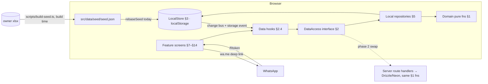
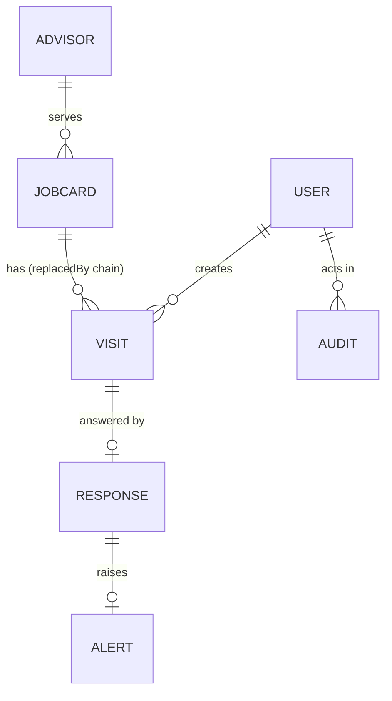

# Low-level design — Chandra Honda PSF (phase 1 demo)

> Numbered, self-contained sections: brief a task with only the sections it needs (e.g. `LLD §2, §8`).
> **Numbers are stable** — update in place, new sections get new numbers, removed ones are marked `(removed)`.
> Size cap: medium, 400 lines. Product rules (questions, triggers, metric formulas, copy) live in `docs/SPEC.md`; this file says where and how they are built.

## §0 Overview

### §0.0 Big picture
| Module | Responsibility | Talks to | Stories |
|---|---|---|---|
| §1 Domain | Pure types, questionnaire config + `show_if` engine, alert rules, metrics, phone/job-card/WhatsApp helpers. Reused server-side in phase 2 | nothing (zod only) | US-02, 04, 08, 09, 12, 14–16 |
| §2 Data-access contract | Repository interfaces, `Result` type, provider, data hooks (TanStack Query) + live invalidation | §1 types | all |
| §3 Local store | localStorage collections, cross-tab lock + change bus, simulated failed save | §2 (implements its subscribe) | S-06, S-13, US-11 |
| §4 Seed pipeline | Build-time xlsx → committed JSON fixture; runtime rebase of dates to "today" | §1, §3 | US-22, S-07 |
| §5 Local repositories | Phase 1 implementation of every §2 interface, role checks inside | §1, §3, §4 | all |
| §6 App shell & shared UI | Root providers (composition root), role guards, admin/support nav, shared components | §2 | US-01 |
| §7 Auth | Sign-in, set-password, reset dialog + `AuthRepo`, `DemoRepo` | §2, §6 | US-01, 20 (S-15), 22 |
| §8 Support | Link list, lookup, generate/send/regenerate/cancel | §2, §6 | US-02–06 |
| §9 Feedback form | `/f/[token]` welcome → steps → callback → thank-you, link states, draft | §2, §1 | US-07–12 |
| §10 Overview | Filter bar + KPI tiles + 7 analytics blocks | §2, §6 | US-14–16 |
| §11 Alerts | Queue, drawer, status/notes, nav badge count | §2, §6 | US-12, 13 |
| §12 Responses | List, detail, edit/delete/restore with step-up password, recently deleted | §2, §6, §1 | US-17, 18, 21 |
| §13 Audit | Append-only audit list | §2, §6 | US-19 |
| §14 Users | Add / deactivate / reactivate support users | §2, §6 | US-20 |


(Source: `.results/lld/dataflow.mmd`.)

**Milestones**
- **M1 · Support → customer loop on a phone** — foundation, seed, sign-in, support screens, customer form with alert creation, deployed to a Vercel preview and opened at 360 px. Closes: the data-access interface shape, cross-tab no-overwrite store, seed rebase, config-driven form engine, Vercel deploy.
- **M2 · Admin console** — overview metrics, alerts queue, responses edit/delete/restore with alert re-run, audit, users, reset, simulated failed save on every screen. Closes: metric correctness (SPEC §5 examples) and the full Definition of Done.

### §0.1 Stack
| Layer | Choice | Why | Rejected alternative |
|---|---|---|---|
| App | Next.js App Router, TypeScript strict, one app at repo root | Owner constraint; Vercel native | Vite SPA (no phase-2 server routes) |
| UI | Tailwind v4 + shadcn/ui (copied into `src/components/ui`) + lucide | Owner constraint; owned source, tokens for dark mode | MUI (heavier, off-brief) |
| Charts | Recharts | Owner constraint | Chart.js |
| Validation | Zod (seed fixture, store collections, form submission, env) | Shared client/server in phase 2 | Valibot |
| Data hooks | TanStack Query v5 over §2 | Loading/saving/error states, cache invalidation, works unchanged against a remote API in phase 2 | Hand-written `useSyncExternalStore` hooks (re-invent mutation state) |
| Storage | localStorage, one key per collection, Web Locks for cross-tab writes | ~1 MB data, synchronous read-modify-write inside a lock, `storage` event gives cross-tab sync free | IndexedDB/Dexie (async, extra dep, no benefit at this size) |
| Seed | Build-time script → committed JSON fixture | No xlsx parser shipped to the browser; fixture reviewable in diffs | Runtime xlsx parsing (≈400 KB bundle, slow first load) |
| Tests | Vitest (unit, jsdom) + Playwright (e2e per S-xx) | Fast unit loop; real browser for tabs, storage, 360 px | Jest; Cypress |
| Dates | `Intl.DateTimeFormat` with `Asia/Kolkata` | No dependency needed | date-fns-tz |

### §0.2 Folder structure
```
src/
  app/                         routes only; each page.tsx renders one feature screen
    layout.tsx providers.tsx robots.ts page.tsx(→/sign-in) not-allowed/
    sign-in/ set-password/     §7
    support/ layout.tsx page.tsx new/page.tsx              §8
    f/[token]/page.tsx                                     §9
    admin/ layout.tsx page.tsx alerts/ responses/ responses/[id]/ responses/deleted/ audit/ users/   §10–§14
  features/<auth|support|feedback-form|admin-overview|admin-alerts|admin-responses|admin-audit|admin-users>/
                               screens, feature components, feature hooks (one folder per feature)
  components/ui/               shadcn generated (foundation)
  components/shared/           §6 shared components (foundation)
  hooks/                       §2.4 generic data hooks (foundation)
  data/access/                 §2 interfaces, Result, provider
  data/local/                  §3 store, §5 repos/, createLocalDataAccess.ts
  data/seed/seed.json          §4 generated fixture (committed)
  domain/                      §1 pure code
  config/env.ts                §0.5
scripts/build-seed.ts  scripts/check.sh
tests/support/  tests/unit/<area>/  tests/e2e/<feature>/
data/seed/Honda_PSF_Survey_30_Dummy_Customer_Responses.xlsx   (input, read-only)
```

### §0.3 Layer map and module dependencies
`app → features → components/shared, hooks → data/access → domain`; `data/local → data/access, domain`. Composition root: `src/app/providers.tsx` is the **only** importer of `@/data/local`.
dependency-cruiser (`.dependency-cruiser.cjs`) rules, all `severity: error`:
| Rule | From | Forbidden to |
|---|---|---|
| domain-pure | `^src/domain` | anything in `src/` outside `src/domain`; any npm package except `zod` |
| access-pure | `^src/data/access` | `src/data/local`, `src/features`, `src/components`, `src/app` |
| local-hidden | `^src/(features\|components\|hooks)` and `^src/app/(?!providers)` | `src/data/local` |
| no-cross-feature | `^src/features/([^/]+)/` | `^src/features/(?!$1)` |
| shared-no-features | `^src/(components\|hooks)` | `src/features`, `src/app` |
| no-circular | any | circular |
ESLint `no-restricted-globals` (`localStorage`, `sessionStorage`) everywhere except `src/data/local/**` and `src/features/feedback-form/draft.ts`.

### §0.4 Packages
Exact versions are pinned by env-setup to the latest stable release of the listed major (lockfile committed). Full table: `.results/lld/packages.md`.
| Package | Major | Purpose | Alternative rejected |
|---|---|---|---|
| next, react, react-dom | 16 / 19 | App framework | — (owner) |
| typescript | 5.9 | Types | — |
| tailwindcss, @tailwindcss/postcss, tw-animate-css | 4 | Styling, slide/step animations | framer-motion |
| shadcn (CLI, dev) + radix-ui, class-variance-authority, clsx, tailwind-merge | latest | UI primitives | MUI |
| lucide-react | latest | Icons | heroicons |
| sonner | 2 | "Copied" / save toasts (shadcn) | custom toast |
| recharts | 3 | Charts | chart.js |
| zod | 4 | Schemas | valibot |
| @tanstack/react-query | 5 | Data hooks | hand-rolled hooks |
| exceljs (dev) | 4 | Read xlsx in build-seed | xlsx/SheetJS (npm copy unmaintained) |
| tsx (dev) | 4 | Run `scripts/build-seed.ts` | ts-node |
| eslint, typescript-eslint, eslint-config-next | 9 / 8 / 16 | Lint | biome |
| prettier, prettier-plugin-tailwindcss | 3 | Format | biome |
| dependency-cruiser | 17 | Layer rules §0.3 | eslint-plugin-boundaries |
| vitest, @vitest/coverage-v8, jsdom, @testing-library/react | 4 / 4 / latest / 16 | Unit tests + coverage | jest |
| @playwright/test | 1.x | E2E, multi-tab, 360 px | cypress |
| gitleaks (binary, CI) | 8 | Secrets scan | detect-secrets |

### §0.5 Config and secrets
`src/config/env.ts` parses with zod; all keys in `.env.example`. No secrets exist in phase 1 (everything is public client code); demo values still stay out of source.
| Key | Example | Use |
|---|---|---|
| `NEXT_PUBLIC_DEMO_PASSWORD` | `Demo@2026` | Password of seeded users; shown as sign-in hint |
| `NEXT_PUBLIC_APP_URL` | `https://psf-demo.vercel.app` | Base of `/f/<token>` links (fallback `window.location.origin`) |
| `NEXT_PUBLIC_DEALER_PHONE` | `+91 44 0000 0000` | Contact line on link-state pages |
Site: `robots.ts` disallows all; root metadata `robots: noindex`.

## §1 Domain (pure)
- **Path:** `src/domain/` · **Depends on:** zod only. Every function deterministic; time comes in as a `now: Date` argument.
- **Ownership (one task per file):** T-01 foundation, frozen: `types, schemas, questionnaire, answers, time, visitStatus, constants, visibility, alertRules` (visibility/alertRules are shared by seed, form, alerts and responses); T-03 (§8): `jobCard, phone, whatsapp`; T-06 (§10): `metrics/**`.
- `constants.ts`: `LINK_EXPIRY_DAYS = 7`, `TEXT_MAX_LENGTH = 1000`, `DEFAULT_RANGE_DAYS = 30`, `RECENT_COMMENTS = 10` (CONVENTIONS §5).

### §1.1 Types (`types.ts`) and schemas (`schemas.ts`, zod mirrors)
```ts
type Role = 'admin' | 'support';
type ISODate = string /* YYYY-MM-DD, IST */; type ISOTime = string /* UTC ISO */;
interface User { id: string; name: string; email: string; role: Role; active: boolean; mustSetPassword: boolean; createdAt: ISOTime }
interface Advisor { id: string; name: string }
interface JobCard { jobCardNo: string; customerName: string; phone: string | null; regNo: string; model: string;
  vehicleType: 'scooter' | 'motorcycle'; serviceType: string; serviceDate: ISODate; advisorId: string }
interface Visit { id: string; jobCardNo: string; phone: string | null; token: string; createdBy: string; createdAt: ISOTime;
  expiresAt: ISOTime; openedAt: ISOTime | null; completedAt: ISOTime | null; cancelledAt: ISOTime | null; replacedBy: string | null }
type VisitStatus = 'created' | 'opened' | 'completed' | 'expired' | 'cancelled';
type QuestionCode = `Q${number}` | `Q${number}a`;
type AnswerValue = number | string | { options: string[]; text?: string };
type AnswerMap = Partial<Record<QuestionCode, AnswerValue>>;
interface ResponseRecord { id: string; visitId: string; questionsVersion: number; submittedAt: ISOTime; answers: AnswerMap; deletedAt: ISOTime | null }
type AlertReason = { kind: 'callback' } | { kind: 'low_rating'; code: 'Q1' | 'Q6' | 'Q11' | 'Q12' };
type AlertStatus = 'open' | 'contacted' | 'resolved';
interface Alert { id: string; responseId: string; reasons: AlertReason[]; status: AlertStatus; notes: { at: ISOTime; by: string; text: string }[]; createdAt: ISOTime; updatedAt: ISOTime }
type AuditAction = 'link.create' | 'link.regenerate' | 'link.cancel' | 'response.edit' | 'response.delete' | 'response.restore'
  | 'alert.create' | 'alert.status' | 'alert.note' | 'user.create' | 'user.deactivate' | 'user.reactivate' | 'user.set_password';
interface AuditEntry { id: string; at: ISOTime; actorId: string; actorName: string; action: AuditAction; entityType: 'visit' | 'response' | 'alert' | 'user';
  entityId: string; oldValue: unknown; newValue: unknown; note?: string }
interface Filters { from: ISODate; to: ISODate; vehicleType?: JobCard['vehicleType']; model?: string; advisorId?: string }
```
Answer storage rows for phase 2 (`value_num/value_text/value_options`): `toAnswerRows(map)` / `fromAnswerRows(rows)` in `answers.ts`.

### §1.2 Questionnaire config (`questionnaire.ts`) — variation point: data, not code
```ts
type QuestionType = 'rating_5' | 'yes_no' | 'yes_partial_no' | 'text' | 'single_select' | 'multi_select_text';
type ShowIf = { op: 'lte' | 'gte'; value: number } | { op: 'eq'; value: number | string } | { op: 'in'; value: string[] };
interface Question { code: QuestionCode; step: 1|2|3|4|5|6; text: string; type: QuestionType; required: boolean;
  parent?: QuestionCode; showIf?: ShowIf; options?: string[]; maxLength?: number /* 1000 for text */; textRequired?: boolean }
interface Questionnaire { version: number; steps: { n: number; title: string }[]; questions: Question[] }
export const QUESTIONNAIRE_V1: Questionnaire   // content = SPEC F-3 tables verbatim
```
`visibility.ts`: `isVisible(q, answers)`, `visibleQuestions(step, answers): Question[]`, `isStepComplete(step, answers): boolean`, `pruneHidden(answers): AnswerMap`, `validateSubmission(answers): { ok: true; answers: AnswerMap } | { ok: false; missing: QuestionCode[] }` (prunes first, then checks required + `textRequired` + `maxLength`).

### §1.3 Alert rules (`alertRules.ts`)
`evaluateAlertReasons(answers): AlertReason[]` (SPEC F-4 step 1; ordered callback first, then Q1, Q6, Q11, Q12) · `formatReasons(r): string` → `"Callback requested · Q12 rated 1"` · `reconcileAlert(existing: Alert | null, reasons, now): { alert: Alert | null; change: 'none' | 'created' | 'reasons_updated' | 'auto_resolved' }` (SPEC F-4 step 4; auto-resolve note text `"Auto-resolved: no alert reason after edit"`).

### §1.4 Metrics (`metrics/`)
`scores.ts`: `ratingScore`, `yesNoScore(code, v)`, `categoryScore(step, answers)` (SPEC F-5 definitions; Q3 reversed, Q2 partial = 50).
`overview.ts`: `computeOverview(input: AnalyticsInput, f: Filters): OverviewData` where
```ts
interface AnalyticsInput { visits: { visit: Visit; jobCard: JobCard }[]; responses: { response: ResponseRecord; visit: Visit; jobCard: JobCard }[]; openAlerts: number; now: Date }
type Metric = { value: number | null; previous: number | null; delta: number | null };   // null → "—", arrow hidden
interface OverviewData { kpis: { responses: Metric; responseRate: Metric; avgQ12: Metric; recommendRate: Metric; openAlerts: number };
  categoryScores: { step: number; title: string; score: number | null }[];
  trend: { granularity: 'week' | 'month'; points: { bucketStart: ISODate; avgQ12: number | null; recommendRate: number | null }[] };
  advisors: { advisorId: string; name: string; responses: number; avgQ6: number | null; q4Yes: number | null; q7Yes: number | null; avgQ12: number | null }[];
  problems: Record<'Q1a'|'Q3a'|'Q6a'|'Q7a'|'Q9a'|'Q11a', { option: string; count: number }[]>;
  questionDetail: { code: QuestionCode; split: { answer: string; count: number }[] }[];
  comments: { responseId: string; serviceDate: ISODate; source: QuestionCode; text: string; q12: number }[] }
```
Rules: filter by **service date**; `responses` input already excludes deleted; response-rate denominator excludes cancelled visits **and replaced visits** (`replacedBy != null`, so a regenerated link counts once); previous period = same length immediately before `from`; comments newest 10.
`filters.ts`: `defaultFilters(now)` (last 30 days), `previousPeriod(f)`, `matches(jobCard, f)`.

### §1.5 Helpers
| File | Function | Rule |
|---|---|---|
| `jobCard.ts` | `normalizeJobCardNo(s): string` | upper-case, strip spaces/dashes → compare on `JC241042` (S-02) |
| `phone.ts` | `toWhatsAppNumber(phone): string \| null` | digits only; 10 digits starting 6–9 → `91…`; `91`+10 → as is; else `null` (landline/blank, S-03) |
| `whatsapp.ts` | `buildWhatsAppUrl(phone, ctx: { name; model; regNo; url })` | SPEC §5 template, `encodeURIComponent` |
| `visitStatus.ts` | `visitStatus(v, now): VisitStatus` | cancelled › completed › expired (`replacedBy` or `now > expiresAt`) › opened › created |
| `time.ts` | `formatIST(t)`, `formatISTDate(d)`, `istDateOf(t)`, `addDays` | display only IST |

## §2 Data-access contract
- **Path:** `src/data/access/`, `src/hooks/` · **Depends on:** §1 types. **Frozen after the foundation.**

### §2.1 Result and errors (`result.ts`)
```ts
type ErrorCode = 'UNAUTHENTICATED' | 'FORBIDDEN' | 'NOT_FOUND' | 'VALIDATION' | 'CONFLICT' | 'ALREADY_COMPLETED'
  | 'BAD_CREDENTIALS' | 'ACCOUNT_DISABLED' | 'BAD_PASSWORD' | 'EMAIL_IN_USE' | 'SAVE_FAILED' | 'UNAVAILABLE';
type RepoError = { code: ErrorCode; message: string; fields?: string[] };
type Result<T> = { ok: true; value: T } | { ok: false; error: RepoError };
const ok, err;   type StepUp = { password: string };   type Topic = 'session'|'visits'|'responses'|'alerts'|'audit'|'users';
```
Every method is `async` and **never throws**; any unexpected exception becomes `SAVE_FAILED` (writes) or `UNAVAILABLE` (reads). Role checks happen **inside** the implementation (not in screens): staff methods return `UNAUTHENTICATED` / `FORBIDDEN`. Step-up methods take `StepUp` and return `BAD_PASSWORD`.

### §2.2 `DataAccess` (`index.ts`)
```ts
interface DataAccess { auth: AuthRepo /*§7*/; demo: DemoRepo /*§7*/; jobCards: JobCardRepo /*§8*/; visits: VisitRepo /*§8*/;
  feedback: FeedbackRepo /*§9*/; analytics: AnalyticsRepo /*§10*/; alerts: AlertRepo /*§11*/; responses: ResponseRepo /*§12*/;
  audit: AuditRepo /*§13*/; users: UserRepo /*§14*/; subscribe(listener: (topics: Topic[]) => void): () => void }
```
The repo interfaces are declared in `src/data/access/repos/<name>.ts` by the foundation with the signatures in their feature sections; feature tasks may not change them (Tier 1).

### §2.3 Provider (`provider.tsx`)
`<DataAccessProvider value={da}>`, `useDataAccess(): DataAccess`. Renders children only after mount (storage is client-only); shows a full-page skeleton before.

### §2.4 Data hooks (`src/hooks/`)
| Hook | Signature | Notes |
|---|---|---|
| `useRepoQuery` | `<T>(key: [Topic \| 'analytics', ...unknown[]], fn: (da) => Promise<Result<T>>) → { data?: T; error?: RepoError; isLoading }` | wraps `useQuery`; error results are surfaced, not thrown |
| `useRepoMutation` | `<I, T>(fn: (da, input: I) => Promise<Result<T>>) → { run(i): Promise<Result<T>>; status: 'idle'\|'saving'\|'error'\|'done'; error?: RepoError; reset() }` | drives every saving state and "Couldn't save, try again" (S-13) |
| `useLiveInvalidation` | `() → void` | mounted once in providers; `da.subscribe` → `queryClient.invalidateQueries()` (all; data is tiny). Phase 2: same hook, `subscribe` backed by polling/SSE |
| `useSession` | `() → { user: User \| null; isLoading }` | key `['session']` |
| `useOpenAlertCount` | `() → number` | key `['alerts','openCount']`, used by the admin nav badge |
Feature-specific hooks live in their feature folder and are built on these two.

### §2.5 Phase 2 swap (design check, not built)
`createRemoteDataAccess()` implements the same §2.2 by calling route handlers; the server re-uses §1 (`validateSubmission`, `evaluateAlertReasons`, `reconcileAlert`, `computeOverview`) with Drizzle repos; `providers.tsx` changes one import. Screens, hooks and §1 unchanged.

## §3 Local store
- **Path:** `src/data/local/store.ts`, `bus.ts`, `fault.ts`, `crypto.ts` · **Depends on:** §1 schemas, §2 `Topic`. **Frozen after the foundation.**

### §3.1 Interfaces
```ts
interface Clock { now(): Date }
type Db = { meta: { schemaVersion: 1; seededAt: ISOTime }; users: (User & { passwordHash: string })[]; advisors: Advisor[];
  jobCards: JobCard[]; visits: Visit[]; responses: ResponseRecord[]; alerts: Alert[]; audit: AuditEntry[] };
class LocalStore {
  constructor(deps: { storage: Storage; locks: LockManager | null; bus: ChangeBus; fault: FaultSwitch; win?: Window })
  read<K extends keyof Db>(k: K): Db[K]                     // parse + zod-validate the key; missing → seed (§4)
  mutate<T>(keys: (keyof Db)[], fn: (draft: Pick<Db, ...>) => T): Promise<T>
  ensureSeeded(now: Date): void; wipeAndReseed(now: Date): Promise<void>
}
class ChangeBus { emit(topics: Topic[]): void; on(l): () => void }
class FaultSwitch { armNextWrite(): void; consume(): boolean }   // sessionStorage `psf:fault`, also armed by `?demoFail=1`
hashPassword(pw: string): Promise<string>   // SHA-256 via crypto.subtle, demo only
```
Keys: `psf:v1:<collection>` (one per `Db` key), `psf:v1:session` (`{ userId }`), drafts `psf:draft:<visitId>` (§9).

### §3.2 Write sequence (no overwrites, S-06)
`mutate` → `navigator.locks.request('psf-db', …)` (direct call if unsupported) → if `fault.consume()` throw `SaveFailed` → **re-read** the listed keys fresh from storage → run `fn` on them → write only the changed keys → `bus.emit(topics)`. Other tabs: `window 'storage'` event on `psf:v1:*` → `bus.emit(topicOf(key))` → §2.4 invalidates. `QuotaExceededError` → `SaveFailed`.

### §3.3 Schema owned


## §4 Seed pipeline
- **Path:** `scripts/build-seed.ts` (run `npm run seed`), output `src/data/seed/seed.json`, runtime `src/data/local/seed.ts` · **Depends on:** §1 (schemas, `evaluateAlertReasons`).
- **Build time:** reads the xlsx with exceljs; applies SPEC §6 seed rules (Q11 `ceil(x/2)`, follow-ups from Q14 hints, Q15 = Yes on CUST-006/014/022, 2–3 extra rating-1 responses, 4 advisors, 5 models, ~10 unanswered visits incl. expired, ~10 job cards with no visit, 1 admin + 2 support users without passwords); deterministic (fixed PRNG seed) so re-running gives an identical file; validates with `SeedSchema`. Job card `JC-24-1042` = SPEC §5 Ramesh Kumar row and has **no** visit.
- **Fixture shape:** same as `Db` but every timestamp is `{ dayOffset: number; minute: number }` (≤ 0, relative to load day) and alerts carry their seeded status/notes.
- **Runtime:** `rebaseSeed(seed, now, password): Promise<Db>` → absolute dates counted back from `now`'s IST day; users get `hashPassword(env.NEXT_PUBLIC_DEMO_PASSWORD)`. Called by `ensureSeeded` (no `meta` key) and `wipeAndReseed`.

## §5 Local repositories
- **Path:** `src/data/local/repos/<name>.ts`, composition root `src/data/local/createLocalDataAccess.ts` (`(deps: { storage; locks; clock; win }) => DataAccess`). **Depends on:** §1, §2, §3.
- Each repo is a class taking `{ store: LocalStore; clock: Clock; session: SessionReader }` (`SessionReader.current(): User | null` reads `psf:v1:session` + `users`; deactivated → null).
- The foundation (T-01) creates **every** repo file with the full class signature; methods not yet built return `err('UNAVAILABLE', 'Not built yet')`. After T-01 each file below has exactly one owning task, which replaces the bodies; the composition root never changes. Frozen helper files are complete in T-01 and imported, never edited, by feature tasks.
| File | Exports | Owner task (§) | Milestone |
|---|---|---|---|
| `auth.ts`, `demo.ts` | AuthRepo, DemoRepo | T-02 (§7) | M1 |
| `jobCards.ts` | JobCardRepo | T-03 (§8) | M1 |
| `visits.ts` | VisitRepo + `toVisitSummary(visit, jobCard, now): VisitSummary` (pure mapper, also imported read-only by `responses.ts`, hence T-08 depends on T-03) | T-03 (§8) | M1 |
| `feedback.ts` | FeedbackRepo | T-04 (§9) | M1 |
| `token.ts` | `encodeToken(visit): string`, `decodeToken(token): TokenPayload \| null` (§9 Token) — used by seed runtime, `visits.ts`, `feedback.ts` | T-01, **frozen** | M1 |
| `auditWriter.ts` | `appendAudit(draft: { audit: AuditEntry[] }, entry: Omit<AuditEntry, 'id' \| 'at'>, now: Date): AuditEntry` — the only audit writer, used by every writing repo | T-01, **frozen** | M1 |
| `analytics.ts` | AnalyticsRepo | T-06 (§10) | M2 |
| `alerts.ts` | AlertRepo | T-07 (§11) | M2 |
| `responses.ts` | ResponseRepo | T-08 (§12) | M2 |
| `audit.ts` | AuditRepo (`listAudit`, read side only) | T-09 (§13) | M2 |
| `users.ts` | UserRepo | T-10 (§14) | M2 |

## §6 App shell & shared UI (foundation)
- **Paths:** `src/app/layout.tsx`, `providers.tsx` (composition root: QueryClient, `createLocalDataAccess(window…)`, `DataAccessProvider`, `useLiveInvalidation`, `Toaster`), `src/app/admin/layout.tsx`, `src/app/support/layout.tsx`, `src/app/not-allowed/`, `src/components/shared/`, `src/app/globals.css` (tokens: slate base, accent `--brand` dealership red, status green/amber/red, radius 12–16 px).
| Component | Props | Use |
|---|---|---|
| `RoleGuard` | `{ role: Role; children }` | no session → `/sign-in`; wrong role → `/not-allowed`; `mustSetPassword` → `/set-password` |
| `AdminShell` | `{ children }` | sidebar ≥ md, bottom tab bar < md (Overview · Alerts(badge) · Responses · More → Recently deleted, Audit, Users, Simulate failed save, Reset demo data, Sign out); nav items in `adminNav.ts`, complete |
| `SupportShell` | `{ children }` | top bar, user name, Sign out |
| `DemoLabel` | — | "Demo — sample data" chip in both shells |
| `StatusBadge` | `{ kind: VisitStatus \| AlertStatus }` | one colour map for the whole app |
| `FilterBar` | `{ value: Filters; onChange; options: FilterOptions }` + `useFiltersFromUrl()` | Overview and Responses; filters live in the URL query |
| `PasswordPromptDialog` | `{ open; title; onConfirm(pw): Promise<Result<unknown>>; onClose }` | step-up; shows "Password incorrect" on `BAD_PASSWORD` |
| `ConfirmDialog` | `{ open; title; body; confirmLabel; destructive?; onConfirm; onClose }` | cancel link, delete, reset |
| `SaveState` | `{ status; error?; onRetry }` | spinner while saving; "Couldn't save, try again" + Retry (S-13) |
| `EmptyState` | `{ icon; title; hint? }` | every empty list/block |
| `MetricValue` | `{ value: number \| null; format }` | renders "—" for null (S-10) |
| `ResetDemoDialog` | `{ open; onClose }` | text of SPEC US-22; calls `da.demo.resetDemoData()` then `/sign-in` |

## §7 Auth
- **Paths:** `src/features/auth/` (`SignInScreen`, `SetPasswordScreen`), routes `src/app/sign-in/`, `src/app/set-password/`; repos §5 `auth.ts`, `demo.ts`.
```ts
interface AuthRepo { signIn(email: string, password: string): Promise<Result<User>>;      // BAD_CREDENTIALS, ACCOUNT_DISABLED
  signInAsDemo(who: 'admin' | 'support1' | 'support2'): Promise<Result<User>>;
  setOwnPassword(newPassword: string): Promise<Result<User>>;   // VALIDATION (<8 chars, mismatch handled in UI); audit user.set_password
  signOut(): Promise<Result<void>>; currentUser(): Promise<Result<User | null>> }
interface DemoRepo { resetDemoData(): Promise<Result<void>>; armFailedSave(): Promise<Result<void>> }
```
- Email match is case-insensitive. After sign-in: admin → `/admin`, support → `mustSetPassword ? /set-password : /support`. Sign-in shows the demo password hint from env and a "Reset demo data" link (§6 `ResetDemoDialog`). Reset signs out every tab (session key removed → `storage` event → `RoleGuard` redirects).

## §8 Support
- **Paths:** `src/features/support/` (`SupportListScreen`, `NewLinkScreen`, `LinkActions`, `JobCardDetailsCard`), routes `src/app/support/**`; repos §5 `jobCards.ts`, `visits.ts`. Role: support or admin.
```ts
interface VisitSummary { id: string; jobCardNo: string; customerName: string; regNo: string; model: string; serviceDate: ISODate;
  phone: string | null; status: VisitStatus; createdAt: ISOTime; expiresAt: ISOTime; url: string; whatsappUrl: string | null }
interface JobCardRepo { getJobCard(jobCardNo: string): Promise<Result<{ jobCard: JobCard & { advisorName: string }; current: VisitSummary | null }>>; // NOT_FOUND
  listFreshJobCards(): Promise<Result<string[]>> }
interface VisitRepo { listMyVisits(q?: { search?: string }): Promise<Result<VisitSummary[]>>;   // createdBy = me, current links only (replacedBy null), newest first
  createVisitLink(i: { jobCardNo: string; phone: string | null }): Promise<Result<VisitSummary>>;   // CONFLICT if a current link exists, ALREADY_COMPLETED
  regenerateLink(visitId: string): Promise<Result<VisitSummary>>;   // new visit, old.replacedBy = new.id, audit link.regenerate
  cancelLink(visitId: string): Promise<Result<VisitSummary>> }      // sets cancelledAt, audit link.cancel
```
- Lookup normalises with §1.5 `normalizeJobCardNo`; search matches job card (normalised) or reg. no (spaces ignored).
- Edited phone is saved on the visit; `whatsappUrl` is `null` when `toWhatsAppNumber` is null → Send button disabled with "Enter a mobile number to send on WhatsApp"; Copy link still works.
- `current` found → show its status: Completed → "Feedback already received", no actions; otherwise show link + Resend/Regenerate/Cancel instead of Generate.
- Expiry: `createdAt + 7 days`. Regenerate is allowed on created/opened/expired; Cancel on created/opened/expired.
- Every create/regenerate/cancel writes audit and shows `SaveState`.

## §9 Feedback form
- **Paths:** `src/features/feedback-form/` (`FeedbackFlow`, `WelcomeStep`, `QuestionStep`, `CallbackStep`, `ThankYou`, `LinkStateScreen`, `fields/` registry, `useFormMachine.ts`, `draft.ts`), route `src/app/f/[token]/page.tsx`; repo §5 `feedback.ts` (uses frozen `token.ts`). No sign-in.
```ts
type FormContext = { state: 'ready'; visitId: string; customerName: string; model: string; regNo: string; serviceDate: ISODate; questionnaire: Questionnaire }
  | { state: 'expired'; replaced: boolean } | { state: 'completed' } | { state: 'invalid' };
interface FeedbackRepo { getVisitByToken(token: string): Promise<Result<FormContext>>;
  markOpened(token: string): Promise<Result<void>>;                            // sets openedAt once
  submitResponse(token: string, answers: AnswerMap): Promise<Result<{ callbackRequested: boolean }>> }  // VALIDATION, ALREADY_COMPLETED, NOT_FOUND
```
- **Token (phase 1 only, `token.ts`):** `base64url(JSON {v: visitId, j: jobCardNo, c: createdAt, e: expiresAt, p: phone}) + '.' + 8 random chars`. `getVisitByToken`: decode fails or job card unknown → `invalid`; visit missing in this browser → import it from the payload (S-12, cross-device); then map `visitStatus` → state (`replacedBy` → `expired, replaced: true`; cancelled → `invalid`). Phase 2 tokens are opaque; screens only see `FormContext`.
- **Submit (one `mutate` over visits, responses, alerts):** `validateSubmission` → store pruned answers, `questionsVersion` → `completedAt` → `evaluateAlertReasons` → if any, create Alert `open` + audit `alert.create` (actor "system").
- **UI state:** `useFormMachine` reducer `{ phase: 'welcome' | 'step' | 'thanks'; step: 1..6; answers }`; `QuestionStep` renders `visibleQuestions(step, answers)` through `fields/index.ts`: `Record<QuestionType, FieldComponent>` (new type = new file + one map entry); follow-ups slide in (tw-animate-css). Next disabled until `isStepComplete`. Draft: `draft.ts` saves answers + step to `psf:draft:<visitId>` on every change, restores on load, clears on submit.
- Failed submit → `SaveState` error, answers kept, Retry. Text fields show counter `n/1000`.

## §10 Admin overview
- **Paths:** `src/features/admin-overview/` (`OverviewScreen`, `blocks/KpiTiles.tsx`, `CategoryScores.tsx`, `TrendChart.tsx`, `AdvisorTable.tsx`, `ProblemBreakdown.tsx`, `QuestionDetail.tsx`, `RecentComments.tsx`), route `src/app/admin/page.tsx`; repo §5 `analytics.ts`. Role: admin.
```ts
interface FilterOptions { models: string[]; advisors: Advisor[]; vehicleTypes: JobCard['vehicleType'][] }
interface AnalyticsRepo { getAnalytics(f: Filters): Promise<Result<OverviewData>>; getFilterOptions(): Promise<Result<FilterOptions>> }
```
- Implementation = join store collections into `AnalyticsInput` (non-deleted responses) and call §1.4 `computeOverview`. Each block is a pure presentational component taking its slice of `OverviewData`; skeleton while loading; `MetricValue`/`EmptyState` for nulls. Advisor table sort is local state; problem block has a follow-up `Select`. Grid: 1 column < md, 2–3 columns ≥ lg. Chart colours from one `chartColors` map in the feature.

## §11 Alerts
- **Paths:** `src/features/admin-alerts/` (`AlertsScreen`, `AlertRow`, `AlertDrawer`), route `src/app/admin/alerts/`; repo §5 `alerts.ts`. Role: admin.
```ts
interface AlertView extends Alert { customerName: string; phone: string | null; model: string; regNo: string; reasonsText: string }
interface AlertRepo { listAlerts(f?: { status?: AlertStatus }): Promise<Result<AlertView[]>>;   // newest first, excludes alerts of deleted responses
  countOpen(): Promise<Result<number>>;
  updateAlert(id: string, patch: { status?: AlertStatus; note?: string }): Promise<Result<AlertView>> }  // audit alert.status (old → new) and/or alert.note
```
- Any status may move to any other (Resolved → Open = reopen). Rows tinted by status via `StatusBadge` colours; empty → "No alerts — all customers happy". Drawer links to `/admin/responses/<responseId>`.

## §12 Responses
- **Paths:** `src/features/admin-responses/` (`ResponsesScreen`, `ResponseDetailScreen`, `ResponseEditor`, `DeletedScreen`), routes `src/app/admin/responses/**`; repo §5 `responses.ts`. Role: admin.
```ts
interface ResponseListRow { id: string; serviceDate: ISODate; customerName: string; model: string; advisorName: string; q12: number; hasAlert: boolean }
interface ResponseDetail { response: ResponseRecord; visit: VisitSummary; jobCard: JobCard & { advisorName: string }; questionnaire: Questionnaire; alert: Alert | null }
interface ResponseRepo { listResponses(f: Filters): Promise<Result<ResponseListRow[]>>; getResponse(id: string): Promise<Result<ResponseDetail>>;
  editResponse(id: string, answers: AnswerMap, s: StepUp): Promise<Result<ResponseDetail>>;
  deleteResponse(id: string, s: StepUp): Promise<Result<void>>; restoreResponse(id: string, s: StepUp): Promise<Result<void>>;
  listDeleted(): Promise<Result<{ id: string; customerName: string; serviceDate: ISODate; deletedAt: ISOTime }[]>> }
```
- **Edit (one `mutate`):** check password → `validateSubmission` (prunes hidden follow-ups) → audit `response.edit` with old/new of **changed codes only** (SPEC §5 example) → `reconcileAlert` → per `change`: `created` audit `alert.create`; `auto_resolved` audit `alert.status open → resolved` with note; `reasons_updated` updates reasons.
- **Delete:** sets `deletedAt` (alert untouched but hidden everywhere because its response is deleted); audit `response.delete` with old value. **Restore:** clears `deletedAt`; alert reappears with its previous status; audit `response.restore`. Visit stays completed.
- The editor renders `visibleQuestions` with plain shadcn inputs (no import of §9 `fields/`, rule no-cross-feature §0.3), so changing Q1 to 4 hides Q1a live. Long texts truncated in the list, full on detail.

## §13 Audit
- **Paths:** `src/features/admin-audit/AuditScreen.tsx`, route `src/app/admin/audit/`; repo §5 `audit.ts`. Role: admin.
```ts
interface AuditRepo { listAudit(f?: { action?: AuditAction }): Promise<Result<AuditEntry[]>> }   // newest first; no write method exposed
```
- `appendAudit` in frozen `repos/auditWriter.ts` (T-01, §5) is the only writer; the collection is append-only. Old → new rendered as compact JSON, truncated with "Show more".

## §14 Users
- **Paths:** `src/features/admin-users/` (`UsersScreen`, `AddUserDialog`), route `src/app/admin/users/`; repo §5 `users.ts`. Role: admin.
```ts
interface UserRepo { listUsers(): Promise<Result<User[]>>;
  createSupportUser(i: { name: string; email: string; tempPassword: string }): Promise<Result<User>>;  // EMAIL_IN_USE (case-insensitive), VALIDATION; mustSetPassword = true; audit user.create
  setUserActive(id: string, active: boolean): Promise<Result<User>> }   // FORBIDDEN on self; audit user.deactivate / user.reactivate
```
- A deactivated user's open session is dropped by `SessionReader` (returns null) → `RoleGuard` → sign-in shows "Account disabled, contact admin" on next attempt.

## Frozen after the foundation
`package.json`, lockfile, `next.config.ts`, `src/app/layout.tsx`, `src/app/providers.tsx`, `src/app/globals.css`, `src/app/admin/layout.tsx`, `src/app/support/layout.tsx`, `src/components/ui/**`, `src/components/shared/**`, `src/hooks/**`, `src/data/access/**`, `src/data/local/{store,bus,fault,crypto,seed,createLocalDataAccess}.ts`, `src/data/local/repos/{token,auditWriter}.ts`, `src/domain/{types,schemas,questionnaire,answers,time,visitStatus,constants,visibility,alertRules}.ts`, `src/config/env.ts`, `tests/support/**`, gate configs (tsconfig.json, eslint.config.mjs, prettier config, .dependency-cruiser.cjs, vitest.config.ts, playwright.config.ts, postcss.config.mjs, components.json, scripts/check.sh, .env.example). A feature needing a change here raises `Needs file:`. Repo stubs (§5 table rows not marked frozen), `src/data/seed/seed.json` (minimal in T-01, generated by T-02) and placeholder `page.tsx` routes are created by T-01 and then owned by the single task named in §5 / TASKS.md, so they are not frozen.

## Changes since last milestone
| Milestone | Section | Change | Why | Ref |
|---|---|---|---|---|
| plan | §1, §5, §9, §13, Frozen | `constants/visibility/alertRules` and `repos/token.ts` moved to the foundation and frozen; `appendAudit` moved from `repos/audit.ts` to new frozen `repos/auditWriter.ts`; `audit.ts` is the read side (T-09); `toVisitSummary` exported from `visits.ts` (T-03) | Shared by 2+ tasks; one owner per file | TASKS.md planning |
